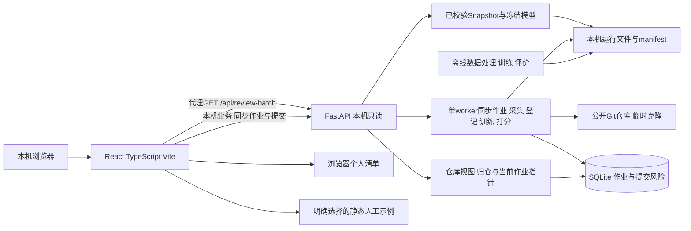
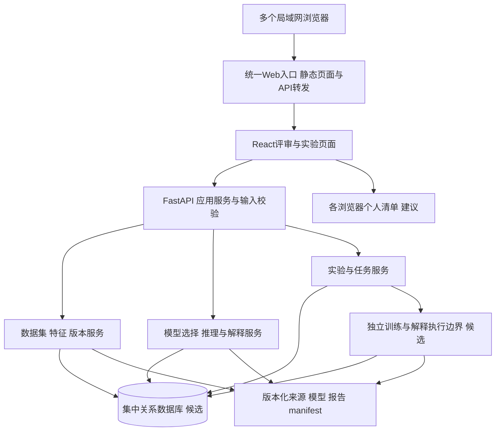
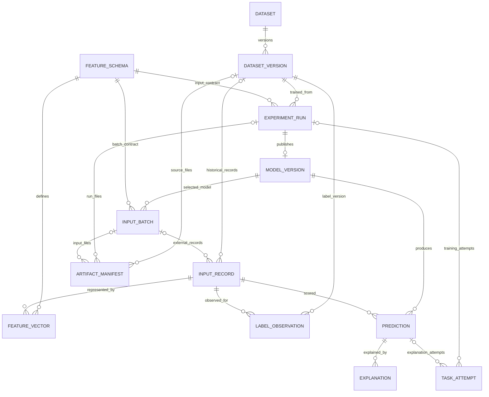
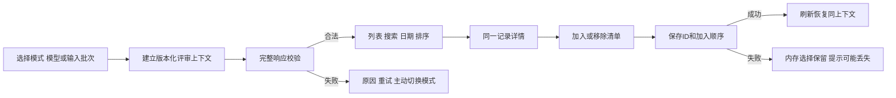

# JIT 缺陷预测系统 · 产品设计文档

## 前言

本文说明共享提交评审产品的目标架构、模块、输入契约、数据与验证设计，配合[产品需求文档](产品需求文档.md)使用。结构采用本项目提供的设计模板，参考旧设计的可追溯与异常处理思路，按当前实现和用户决定重新组织。

当前系统采用 React、FastAPI、SQLite 和可追溯模型产物。2026-10-19 按用户实看反馈删除团队凭证与独立工具页面，以项目接入—分析—提交审查为主线，验证报告为次级入口；底层模型/预测/存档能力保留。之前增量是实现历史，不要求保留其页面结构。

本轮数据模型按最小目录／预测链路实施，使用标准库 sqlite3 和显式版本迁移；后文十三张表仍是完整产品候选结构，不能据此声称全部已落库。既有五方法与 compare-methods 保留，运行身份与位置分离以容纳训练耗时不同的复现目录。实际契约以 OpenAPI 的 implementation-status 为准。

## 一、版本信息

| 项目 | 内容 |
|---|---|
| 版本号 | v1.0 文档基线评审稿，与需求文档一致 |
| 创建日期／更新日期 | 2026-10-12／2026-10-12 |
| 整理人 | Codex，按荀浩要求整理 |
| 审核人 | 待用户及团队实际评审 |
| 所属change | `define-shared-review-product-baseline` |
| 资料核对日期 | 2026-10-12；历史报告按原日期引用 |
| 状态 | 当前事实可查；目标接口、schema与数据库属于候选设计，技术检查不代表业务签审 |

## 二、变更日志

| 时间 | 版本号 | 变更人 | 主要变更内容 |
|---|---|---|---|
| 2026-10-12 | v1.0 | Codex（按荀浩要求） | 按本项目模板建立共享评审目标设计；区分当前历史基线与新输入／集中存储／多人使用，补模块、契约、流程和数据关系 |
| 2026-10-16 | v1.0 | Codex（按荀浩要求） | change `connect-model-prediction-workbench`：前端接入共享应用壳与 hash 导航、模型中心、新建预测与预测结果页；补客户端凭据处理、六字段粘贴导入、结果链接与重开的请求契约与限制 |
| 2026-10-22 | v1.1 | Codex（按荀浩要求） | change `add-project-management`：后端新增项目登记/重命名/硬删与分析记录列表/删除接口，项目管理与分析执行分离 |
| 2026-10-22 | v1.1 | Codex（按荀浩要求） | change `rebuild-project-workspace`：前端改为项目→分析两层信息架构，新增新建项目页与项目页（当前结果/发起分析/分析记录），补失败响应、空结果与旧地址兼容 |
| 2026-10-22 | v1.2 | Codex（按荀浩要求） | change `select-current-analysis`：分析记录可设为当前结果（只改视图指向），项目管理移到项目列表卡片菜单，分析选项常显，补返回链接 |
| 2026-10-22 | v1.3 | Codex（按荀浩要求） | 现代外观层：卡片/按钮/表格/记录的统一表面与悬停、胶囊状态、半透明顶栏；分析选项改为默认收起并显示参数摘要；分析记录用单选圆点切换当前结果，不再放独立按钮（视觉与交互调整，不改数据契约） |

后续版本通过Git记录保留，不继承旧目录的批准史。目标方案变动应同步需求、API与相关功能change。

## 三、文档说明

### 名词解释

| 术语／缩略词 | 说明 |
|---|---|
| DTO／OpenAPI | 传输对象／机器可读HTTP接口说明 |
| featureSchemaVersion | 模型要求的字段、顺序、类型、单位和转换规则版本 |
| datasetVersion／runId／modelId | 数据版本／实验运行／模型版本的独立标识 |
| batchId／recordId | 外部特征批次／批内唯一记录标识；没有Git SHA时不编造真实提交ID |
| Artifact／manifest | 来源、输入、模型和报告等文件产物／其身份与校验清单 |
| attempt | 一次任务执行尝试；失败重试另建记录并关联原尝试 |
| LAN／origin | 局域网／浏览器协议、主机与端口组成的应用地址上下文 |
| pending／ready／failed | 解释等待／可用／失败状态，与预测本身分别记录 |

### 设计依据与确认程度

用户已确认提交评审主线、特征文件或JSON入口、局域网共享。源码可核对六字段单基线、只读历史回放和本地清单。公开数据集路线来自当前团队资料。

个人审查计划保存在浏览器，按仓库、固定分析和数据版本隔离。当前使用本机无凭据业务访问；模型、数据、输入及事务校验继续执行。完整课程目标与现行产品范围分别标注。

## 四、概要设计

### 系统架构

#### 4.1.1 当前架构（已观察）

图G-D1描述既有历史回放链路；新增目录／JSON 接口共用 FastAPI，SQLite 保存登记和结果。2026-10-18 起多了一条仓库同步链路：界面发起作业后由单个后台 worker 串行执行采集、登记、训练（或降级）与打分，同样写 SQLite。当前仍仅本机监听，没有浏览器模型上传或训练 Web 任务。



前端dev／preview为`127.0.0.1:4173`，API为`127.0.0.1:8000`。API启动校验文件、训练代码、环境和模型；每次GET执行模型推理。修复失效产物后需要核验并重启服务；前端重试不会自动刷新启动时失效的Snapshot。

#### 4.1.2 目标共享架构（待实现）

图G-D2按展示、业务、数据三层表达。统一入口对LAN客户端提供页面与API转发，后端集中管理资源；数据库及执行器的具体选型仍为候选。



服务主机持有数据文件和模型；浏览器通过业务API访问资源，不直接共享数据库文件。共享资源是数据集、模型和实验记录；个人清单先本地保存属于建议。公开部署、账户和跨设备保存另行确认。

| 层／能力 | 当前实现 | 目标候选与取舍／验证门槛 |
|---|---|---|
| 展示与构建 | React／TypeScript／Vite | 延续已有组件与类型契约，新增数据、实验、输入、比较页面；页面数量增加后再决定路由／状态库 |
| API与业务 | FastAPI／Python、Pydantic生态 | 统一应用服务校验、版本选择和响应；计算与HTTP入口分离，避免Web进程直接承担长训练 |
| 共享存储 | SQLite 最小目录／预测库＋版本化 SQL 迁移，模型文件独立保存 | 后续完整数据集／实验结构逐步接入；PostgreSQL／ORM 是扩展候选，未迁移或验收 |
| 文件产物 | manifest与hash校验 | 保留模型、schema、环境与文件关联；集中存储只用受控相对键。单机目录优先，跨主机对象存储另评估 |
| 长任务 | 离线CLI | 候选单个独立worker／执行器及持久任务表；必要时再评估Celery／Redis，不继承旧队列部署承诺 |
| 模型／解释 | NumPy／scikit-learn固定逻辑回归；没有真实解释 | 统一模型适配器，表格深度候选PyTorch；解释逐方法核验输入、基准、单位和预算 |
| LAN入口 | 当前只监听本机 | 目标由一台主机提供团队地址；后端与数据库的暴露范围单独配置，在部署change验证跨客户端、origin及访问控制 |

[SQLite官方适用范围](https://www.sqlite.org/whentouse.html)说明其也可用于应用服务器后端，且同一数据库每次只有一个写入者。因此LAN共享本身不强制选择PostgreSQL；实际并发和运维需求决定选型。表中技术均为设计候选，依赖版本以相应功能change的验证结果锁定。

### 系统模块划分

| 模块ID | 系统—模块—功能点 | 输入与输出 | 关系／异常 | 对应需求 |
|---|---|---|---|---|
| M-01 | 数据—来源／质量／重开 | 固定来源描述与CSV→数据版本、质量报告、原始行定位 | 调用产物存储；重复、hash、编码／字段失败阻止ready | US-01～03、23 |
| M-02 | 数据—特征schema／兼容 | 字段定义与记录→已校验向量、来源及缺口 | 为训练和推理提供同一契约；不同schema拒绝互换 | US-04、24 |
| M-03 | 实验—分区／训练／评价 | 数据版本、schema、方法和冻结配置→run、模型、指标 | 依赖M-01／02及执行器；失败保留attempt，不发布半成品 | US-05～07 |
| M-04 | 模型—登记／选择／校验 | 成功run与manifest→可用模型列表 | 输入版本、依赖、文件hash不一致标为不可用 | US-08 |
| M-05 | 预测—JSON／CSV／解释 | 模型与无标签特征→预测批次、来源、解释状态 | M-02校验、M-04加载；解释失败独立于合法风险 | US-09、16 |
| M-06 | 评审—列表／详情／清单 | 历史／输入批次→用户审查选择 | 稳定标识关联视图，来源切换隔离，保存失败降级 | US-10～15、17～19 |
| M-07 | 分析—比较／趋势／导出 | 同协议run与历史数据→指标对照、聚合、报告 | 不可比不排名；未知／空桶不伪装0比例 | US-20～22 |
| M-08 | 基础—任务／访问／产物 | 应用命令→受控任务、版本化文件及诊断 | DB短事务、独立执行、失败恢复和权限入口 | 支撑M-01～07及NFR-01～04 |
| M-09 | 采集—仓库同步作业 | 公开仓库地址、分支、窗口、提交上限、打分模型选择→同步作业、数据集版本、模型与逐提交风险 | 依 M-01／03／04；单 worker 串行、同参复用、超时与重启中断；只在用户点击时执行，不轮询远端仓库 | US-01、09、10～12、23；RCL-07～09、MC-07 |
| M-10 | 评审—仓库工作区 | 仓库地址、当前视图、提交查询（搜索／日期／排序）、分页与风险分布 | 依 M-09；仓库按规范化地址归并、视图只指向成功作业、失败作业不覆盖视图；分档口径固定 | US-09～12、23；CRR-10～15 |

API层只负责请求契约和应用服务调用；领域模块不读浏览器清单生成标签，也不依赖界面排序计算离线指标。展示层对来源和schema做运行时校验，不能只靠TypeScript类型假定响应合法。

### API清单

接口编号、状态与参数详见§5.2及[OpenAPI离线契约](api/openapi.yaml)。API-01 保留；提交与数据版本查询、数据来源、模型候选／登记／列表／schema／JSON 预测、结果重开、仓库同步与仓库提交查询已实现（API-02、05、08、09、11、16～25），其他操作仍 planned。人工示例由前端静态文件提供。全局错误集中在[全局错误码表](全局错误码表.md)。

仓库分析创建接口接收公开 HTTP(S) 地址与已声明策略，返回真实作业，客户端轮询实际阶段。所有本机业务接口无需凭证，字段/模型/范围校验继续执行；进行中/失败与已有成功分析分别可辨。

### 数据库概要设计

当前运行仍用文件产物，本轮 SQLite 已保存目录元信息、原身份映射、位置、登记记录和单条结果；完整 ER 候选见§5.3，训练任务／标签等候选表尚未落地。模型权重和原始数据留在产物目录，数据库保存受控引用和 hash，不构造缺乏来源的 Git／SZZ 表。

图G-D6为候选鸦爪ER图。`input_batch`用于保存外部特征输入的独立批次身份，使同一个训练run下的多个输入不会混为一份清单。



记录必须且只能归属于数据版本或外部批次之一；任务必须且只能归属于训练run或解释prediction之一。模型在成功run下最多登记一版；不同方法或重复实验分别创建run。图中optional关系对应详细表的可空外键和排他CHECK，不表示无来源对象可直接ready。

## 五、详细设计

### 各模块的详细设计

以下子节使用M-01～M-08模块编号，覆盖数据与模型来源、主流程、异步状态和错误路径；API及数据库分别由§5.2、§5.3承接。

#### 5.1.1 M-01／M-03：数据准备、实验与登记

数据导入建议接收CSV及来源描述（固定版本、hash、引用、字段／标签规则），不执行任意URL抓取。先检查大小、编码、表头、唯一ID、时间、特征与标签，再按版本化纳入规则形成质量统计；规则排除不能隐藏非法原始行。来源不完整、重复或字段非法时不发布ready数据版本。

实验先冻结数据版本、schema、纳入规则、标签、时间成员清单、预处理、模型／种子、阈值及评价规则。仅训练集学习变换；当前固定基线验证不重拟合，新实验若用验证集选择参数，须在测试前确定协议。不同schema消融用独立实验分组。

图G-D3为目标数据／实验时序：

```mermaid
sequenceDiagram
    actor E as Experiment user
    participant UI as Browser
    participant API as Application service
    participant DB as Central database
    participant W as Independent executor
    participant FS as Artifact store
    E->>UI: Import CSV and source descriptor
    UI->>API: Controlled import request
    API->>API: Check source schema labels and limits
    alt Input invalid
        API-->>UI: Row or field failure; no ready version
    else Validated
        API->>FS: Save immutable input and hashes
        API->>DB: Register ready dataset version
        API-->>UI: Dataset version and quality report
    end
    E->>UI: Freeze experiment configuration
    UI->>API: Create experiment
    API->>DB: Save queued run and attempt
    API-->>UI: 202 with runId
    W->>DB: Claim current attempt
    W->>FS: Read verified frozen inputs
    W->>W: Fit train only; evaluate frozen test
    alt Training or artifact failure
        W->>DB: Failed attempt with diagnostic
    else All output checks pass
        W->>FS: Publish complete artifact manifest
        W->>DB: Register succeeded run and ready model
    end
    UI->>API: Query run state
    API-->>UI: State metrics or failure record
```

任务建议状态为queued→running→succeeded／failed。执行器领取及写回核对当前attempt、state和claimToken；心跳／租约期限为实施时配置。失联后将原尝试明确失败，用户重试创建新attempt并关联retryOf；旧执行者不能覆盖新尝试。队列／进程不是ready状态的事实来源，最终以数据库记录及产物校验为准。

先在受控暂存目录写文件，检查内容、hash、数量和manifest，再发布引用与成功状态。文件发布与数据库事务不是同一事务；登记失败留下的未引用文件须可定位清理，已登记文件丢失或损坏时将版本标为invalid，而非继续提供风险。

#### 5.1.2 M-02／M-03：特征、标签、模型与评价协议

**现有冻结方案：** `[ns, nd, nf, ent, la, ld]`原生六字段；五个计数log1p，ent保留原值，训练期拟合标准化；L2逻辑回归，C=1、lbfgs、max_iter=1000、tol=1e-4、class_weight=None、seed=2026、单线程，分类阈值p≥0.5。当前环境参数和锁定依赖见[PROTOCOL.md](../backend/PROTOCOL.md)及[requirements.txt](../backend/requirements.txt)，不在新文档改写其实现。

原始26,855条，按UTC窗口、la>0、la+ld≤10000、nf≤100依次纳入12,374条；不同时间组70%／15%／15%，train=8,669、validation=1,852、test=1,853。当前验证集只检查流程，不调参或重拟合；全部已学习变换只拟合训练。来源与排除数量见[DATA.md](../backend/DATA.md)，真实结果见[原基线报告](evidence/connect-public-data-baseline-review/baseline-report.md)。

**完整Kamei14目标与当前缺口：** 原论文的14项度量见[Kamei等变更度量章节](https://posl.ait.kyushu-u.ac.jp/~kamei/publications/Kamei_TSE2013.pdf)。下表是语义概述，具体聚合、时间、归一化及单位须由可核验来源落实到schema；不是声称现有CSV已实现原论文提取。

| 类别 | 规范字段 | 语义 | 当前来源状态 |
|---|---|---|---|
| 分散 | ns | 涉及子系统数 | 可用：原生`ns`已有；未重建路径定义 |
| 分散 | nd | 涉及目录数 | 可用：原生`nd`标注组件数，等价映射待核查 |
| 分散 | nf | 修改文件数 | 可用：原生`nf`已有 |
| 分散 | entropy | 修改在文件间的分散程度 | 可用：原生`ent`已有，是否按原论文归一化未重新审计 |
| 规模 | la | 增加行数 | 可用：原生`la`已有 |
| 规模 | ld | 删除行数 | 可用：原生`ld`已有 |
| 规模 | lt | 变更前所涉文件代码规模 | **不可得**：固定快照无该列（Size 家族只有`la`、`ld`），不能用`la+ld`替代 |
| 目的 | fix | 该变更是否修复缺陷 | 可用：发布者原生列`fixcount`，按发布者规则`fixcount > 0`转换（空值视为 0） |
| 历史 | ndev | 此前修改所涉文件的开发者数 | 可用：原生`ndev`（History 家族，"Number of past developers"） |
| 历史 | age | 距所涉文件上次修改的平均间隔 | 可用：原生`age`（实数；"Time since last modification"） |
| 历史 | nuc | 所涉文件唯一上次变更的数量 | 可用：原生`nuc`（"Number of past changes"） |
| 经验 | exp | 作者此前变更经验 | 可用：原生`aexp`（Author 家族，"Author experience"） |
| 经验 | rexp | 按历史变更年龄加权的作者经验 | **不可得**：原CSV的`rexp`是Reviewer experience；候选`arexp`只给标签、无定义，无法核验 |
| 经验 | sexp | 作者在相关子系统的过去经验 | 可用：原生`asexp`（"Subsystem author experience"） |

完整目标schema名为`kamei14-v1`，按上述顺序保存，fix为布尔值／模型输入0或1；计数、间隔和经验各有类型／单位。`lt`与`rexp`在固定快照中不可得，因此`kamei14-v1`先以 12 个已核验字段（`ns, nd, nf, entropy, la, ld, fix, ndev, age, nuc, exp, sexp`）ready；补齐`lt`／`rexp`需要第二个公开数据集或发布者提取实现，另立后续 change。六字段兼容schema候选名`openstack-six-v1`；当前HTTP尚无featureSchemaVersion字段，不能要求现有API突然提供该新字段。

发布者标签按bugcount>0为1，零／空为0（未观测到缺陷引入）；非空计数必须非负整数。没有逐条SZZ链路或历史标签可得日期，运行按回顾性评价标注。新数据若标签未知，保存unknown／null并执行明确准入规则，不自动负类；预测请求没有标签。FIX是变更目的，不是该提交将来引入缺陷的标签。

**方法声明状态：** 当前具名注册表有五个经典方法（逻辑回归、决策树、随机森林、高斯朴素贝叶斯、梯度提升树），深度方法零个；方法条目不等于本机已登记模型。compare-methods 已能按评价上下文并列比较，当前覆盖目标为经典至少四个且深度至少四个，失败方法或参数变体不计入达标。

| 类别 | 候选方法 | 输入与适配／验证 |
|---|---|---|
| 经典 | 逻辑回归 | **已登记**（`logistic-regression-l2-v1`）；表格向量，六字段模型保留，新增schema另建run |
| 经典 | Gaussian朴素贝叶斯 | 表格向量；类别顺序、数值与概率输出核验 |
| 经典 | 决策树 | **已登记**（`decision-tree-v1`）；表格向量，深度／叶数与过拟合验证 |
| 经典 | 随机森林 | 表格向量；种子、树数、内存和预测延迟 |
| 经典 | 梯度提升树 | 表格向量；具体实现、依赖及预算后续选定 |
| 深度 | 多层MLP | 数值／布尔向量；PyTorch候选，训练／重载／CPU推理与解释核验 |
| 深度 | 表格ResNet | 向量残差网络；与MLP独立架构，预算及计数口径需复核 |
| 深度 | FT-Transformer | 字段token化；schema顺序、嵌入、训练／预测资源核验 |

表格ResNet和FT-Transformer的研究依据为[Revisiting Deep Learning Models for Tabular Data](https://arxiv.org/abs/2106.11959)，仅支持候选架构思路，不是本项目效果证据。不将任意顺序的度量伪装为自然时间序列；CNN／GRU或预训练代码模型需要真实diff／消息／源码素材，列为后续数据路线。模型统一fit、predict、save／load接口及schema／manifest校验**已实现**：方法以具名条目声明类别、冻结超参、所需依赖、复现口径与解释口径，运行按自身声明的方法、依赖与指标集解析与校验，新增方法不使既有运行失效；先一经典一深度核验资源，再扩展，不盲目启动完整训练。

**深度方法覆盖缺口：** 本表合规的表格型深度候选为 3 个（多层MLP、表格ResNet、FT-Transformer），而课程要求深度方法 ≥4，因此**深度距 ≥4 还差 1 个**；第 4 个候选须为表格型，在实现深度方法时按资源预算选定，不得用参数变体或失败方法凑数。

解释候选：线性模型按相对于训练基准的变换值计算贡献，准确标为log-odds而非概率贡献；树方法可核验TreeSHAP，深度／其他方法核验合适的梯度或模型无关解释。基准、特征原值／变换值、贡献单位、方向和近似误差需保存；每种范围内方法都需真实解释验收，不能用原始数值排序替代。

**评价规则：**

| 项目 | 当前规则（保持） | 扩展说明 |
|---|---|---|
| ROC-AUC／AP | 同一冻结测试；AP为Average Precision，不是梯形PR-AUC；单类记录未定义 | 方法／库／版本和类别数绑定run |
| Precision／Recall／F1 | p≥0.5；保存TP／FP／TN／FN；分母为0返回null＋原因 | 参数／阈值选择只在测试前的训练／验证协议，不能据最终测试调优 |
| Recall@20%LOC (risk-ranked) | 成本原始la+ld；风险降序、UTC时间降序、ID升序；完整前缀，下一项超预算即停止；不跳过或拆分 | 总LOC为0／无正标签返回null；保存预算、实际LOC和条数 |
| Popt（新候选） | 当前未计算 | 候选全成本范围，模型按风险／正LOC密度，oracle按标签／LOC，worst反向；梯形面积归一化(Amodel−Aworst)/(Aoracle−Aworst)。零成本或分母退化则null＋原因，另定零成本协议后才能改规则 |
| 朴素对照 | 原AP无信息参考、全负预测，不是新增训练方法 | 候选变更规模与固定种子随机排序，在同一成员／成本／预算下比较，注明排序方案 |

旧文档候选成本max(1,LA+LD)、风险密度排序及Precision退化填0，与当前方案不同，不能合并报告或覆盖冻结结果。Popt要标全范围及density-ranked，与现有风险排序LOC指标分开。重跑当前基线需分区完全一致、风险和已定义指标绝对误差≤1e-8；新深度模型误差／随机性按独立协议冻结，不虚构逐字节一致。

#### 5.1.3 M-04／M-05：新特征预测和独立解释

先选择ready模型；读取该模型的schema和已拟合预处理，核对环境／文件／训练run，再检查请求字段、类型、单位、非有限值、数量和上下文。身份和时间是元数据，标签／未来观测不进入特征。JSON建议单条，CSV建议10MiB／1,000条上限且整批失败；这些均为待验证默认值。

图G-D4为目标新输入时序：

```mermaid
sequenceDiagram
    actor R as Reviewer
    participant UI as Browser
    participant API as Prediction service
    participant M as Verified model adapter
    participant DB as Central database
    participant X as Explanation executor
    R->>UI: Select model; provide JSON or CSV features
    UI->>API: Predict with modelId and featureSchemaVersion
    API->>API: Check write access input limits and schema
    alt Invalid input or unavailable model
        API-->>UI: Explicit failure; no partial batch
    else Compatible input
        API->>M: Transform using fitted pipeline and infer
        M-->>API: Finite scores and exact record count
        API->>DB: Register input batch and predictions atomically
        API-->>UI: 201 with batch model run and explanation state
        API->>X: Request explanation for same input and model
        alt Explanation succeeds
            X->>DB: Ready explanation with method and contributions
        else Explanation times out or fails
            X->>DB: Failed explanation and reason
        end
        UI->>API: Query explanation
        API-->>UI: Pending ready or failed for same prediction
    end
    R->>UI: Open detail and add to personal shortlist
```

合法风险数量须与输入一一对应，取正类1输出，值须有限且在[0,1]；数量或数值非法时整个预测失败。解释可异步完成，失败不改写已经合法的风险；UI独立显示等待、失败／超时或贡献结果。解释保存方法、基准、方向、输入／模型hash与版本；贡献单位可为log-odds或概率尺度等，但必须准确标注，不将贡献说成真实缺陷原因。

新输入的batchId独立于模型训练runId：同模型的两个输入批次不是同一评审上下文。外部recordId只要求批内唯一；Git SHA可选并单独保存。schema校验只能确认调用方声明的特征格式，不能证明其确实由指定源码计算。

#### 5.1.4 M-06：工作台、时间与清单

当前演示与历史模式沿用既有契约。目标新增`feature-input`来源，与historical／demo区分，显示“用户提供特征 · 模型估计”。完整来源建议包含project、modelId、modelSha256、训练runId、featureSchemaVersion、batchId和输入hash。

新输入time允许缺失，显示“未提供”；在日期筛选时排除无时间记录并显示排除数。风险排序先比较风险降序，同分有时间者优先并按时间降序，最后recordId升序；时间排序将缺失时间放末尾。现有历史记录全部有合法时间，既有排序规则保持原样。

图G-D5为目标上下文与个人选择流程：



当前演示键按项目／版本，历史键按模式／项目／版本／runId。新输入若继续本地清单，目标键还需batchId／schema／modelId，建议升级存储版本并保留旧键可恢复，不能直接改写现有实现。切换来源取消或忽略旧请求；详情按完整ID关联，关闭返回原焦点与查询。共享origin的变化会改变浏览器保存上下文，应在部署说明中告知。

#### 5.1.5 M-07／M-08：分析、报告与诊断

比较键至少包括数据版本、纳入与标签hash、特征schema、完整分区成员hash、评价／成本／排序规则和阈值政策；不同键不可直接排名。同一模型重复配置不是独立方法，失败run不伪装成成功指标。

趋势按注明的时区与时间桶聚合固定历史记录：数量、观测正标签比例、风险分布分列；外部新输入没有真实标签，不参与“观测缺陷比例”计算。空桶／未知标签返回null与原因。列表筛选不更改完整实验指标。本轮按**离线预计算**落地：`run` 按月（固定 UTC+08:00）聚合全部纳入记录并写入 `summary.trendBuckets`，随现有免凭据 `GET /api/review-batch` 供给；聚合只含计数与风险分布，服务仍不读逐条标签；`verify` 对测试分区逐条重算、对全量与各分区做守恒核对；桶内样本少于声明阈值（默认 20）时比例与风险分布为空值加原因。

趋势视图在此之上提供三层信息：按运行摘要画出的**分区带**（边界与摘要一致、按桶域裁剪，标签不写死）；**估计与观测的差异**洞察（率差排序、样本不足排除；只有中位风险时把估计标注为近似，并统一声明这是诊断信号、风险未校准、不代表缺陷率）；以及**按桶下钻**——每桶把自身起止（结束端取下段起点减一秒）换算成界面时区日期，跳转到带 `start`／`end` 的工作台。

工作台地址上的 `start`／`end` 是**查询种子**：Asia/Shanghai、含两端、与数据来源无关，只在挂载时读取，手动修改不写回地址；非法或起止颠倒时整体忽略，并在筛选错误提示之外的独立提示中说明。

导出报告关联单个run，包含来源、分区、模型配置、指标、全部产物hash、失败尝试及限制；不包含任意客户端路径。日志用requestId／runId／batchId／attemptId关联，记录错误与阶段耗时，不记录认证凭据。当前本机业务 API 无凭证门槛，现行访问边界由本机监听与业务输入/模型准入保证。

### API详细设计

#### 5.2.1 清单、版本与访问约定

[OpenAPI离线契约](api/openapi.yaml)是字段和响应结构的机器可读载体，采用[OpenAPI3.1](https://spec.openapis.org/oas/v3.1.0.html)。每个操作有`x-api-id`、故事引用及`x-implementation-status`，planned表示待实现草案，不是已上线接口。错误码的唯一文档定义见[全局错误码表](全局错误码表.md)。

新接口统一`/api/v1`；datasetVersion、runId、modelId、batchId和predictionId采用目标数据库的UUID标识，featureSchemaVersion采用命名版本字符串。现有API-01的hash型datasetVersion／runId和字符串model.id原样保留；未来登记旧产物时保留旧身份映射，不直接改旧响应。

本机业务 API 不接受或依赖团队角色，自报认证头不改变访问。业务请求仍受严格输入、模型、来源与存储校验；requestId/no-store 与可公开诊断保留。

浏览器请求不传 Authorization，也没有凭证 provider 或代际。请求通过 AbortSignal 与明确的项目/分析/运行身份隔离，晚到响应不能覆盖目标对象。创建分析只由显式操作触发一次，不自动重发；网络中断时保留可修正输入并如实说明未知状态。

| ID／状态 | 模块／HTTP方法与URL | 入参 → 出参／返回 | 鉴权／调用方／故事 |
|---|---|---|---|
| API-01 implemented | M-06 GET `/api/review-batch` | 无参数 → HistoricalBatch；200或503／500，成功Cache-Control:no-store | 当前本机无鉴权；UI-03／04／05；US-10～19 |
| API-02 implemented | M-01 GET `/api/v1/datasets` | 无参数 → DatasetRegistry（按名称分组的版本与质量摘要），200／503 | 本机直接访问；UI-01；US-01／23 |
| API-03 planned | M-01 POST `/api/v1/datasets/import` | multipart descriptor＋CSV → DatasetImportResult，201；非法／hash不符422，超限413 | 建议write；UI-01；US-01～03／23 |
| API-04 planned | M-01 GET `/api/v1/datasets/versions/{datasetVersion}/quality` | UUID版本 → QualityReport，200／404 | 建议read；UI-01；US-02／03 |
| API-05 implemented | M-02 GET `/api/v1/feature-schemas/{featureSchemaVersion}` | 权威字段声明、不可得原因及 jsonPredictionSupported，200／404 | 本机直接访问；US-04／24；新页面待建 |
| API-06 planned | M-03 POST `/api/v1/experiments` | 数据／schema／方法／预注册协议／参数／seed → RunAccepted，202；不兼容422 | 建议write；UI-02；US-05～07 |
| API-07 planned | M-03 GET `/api/v1/experiments/{runId}` | UUID运行 → ExperimentRun，200／404；失败状态仍是200记录 | 建议read；UI-02；US-05～07／23 |
| API-08 implemented | M-04 GET `/api/v1/models` | 可选state → 实际登记 ModelList，200／503 | 本机直接访问；US-08；新页面待建 |
| API-09 implemented | M-05 POST `/api/v1/predictions` | 单条原始六字段 JSON → 已保存 PredictionBatch，201；404／413／422／503／500 | 本机直接访问；US-09／24；解释 not-supported |
| API-10 planned | M-05 GET `/api/v1/predictions/{predictionId}/explanation` | UUID预测 → Explanation，200／404；pending／failed仍200状态记录 | 建议read；UI-04；US-16 |
| API-11 implemented | M-05 GET `/api/v1/prediction-batches/{batchId}` | UUID批次 → 保存的不可变 PredictionBatch，200／404／503 | 本机直接访问；US-09／23；不重新推理 |
| API-12 planned | M-05 POST `/api/v1/prediction-batches` | multipart modelId／schema／project／CSV → PredictionBatch，201；不存在404、整批非法422、超限413、模型503／推理500 | 建议write；UI-07；US-09／24 |
| API-13 planned | M-07 GET `/api/v1/comparisons` | runIds（逗号分隔，至少2项）→ Comparison，200／404／409 | 建议read；UI-06；US-20 |
| API-14 planned | M-07 GET `/api/v1/trends` | runId、bucket(day／week／month)，时区固定Asia/Shanghai → Trend，200／404／409 | 建议read；UI-06；US-21 |
| API-15 planned | M-07 GET `/api/v1/experiments/{runId}/report` | UUID成功运行 → ExperimentReport JSON下载，200／404／409 | 建议read；UI-02／06；US-22 |
| API-16 implemented | GET `/api/v1/model-candidates` | 主机受控目录 → 候选及 manifest hash，200 | admin；候选不代表 ready |
| API-17 implemented | POST `/api/v1/models/register` | candidateId／expectedManifestSha256 → 模型目录，201 新增／200 复用；404／409／422／503 | admin；与 CLI 共用完整准入 |
| API-18 implemented | M-01 GET `/api/v1/commits` | version、可选 module、limit 1..500、offset → CommitPage（摘要，不含特征），200／404／422 | 本机直接访问；US-01／23 |
| API-19 implemented | M-01 GET `/api/v1/commits/{commitId}` | version + commitId → CommitDetail（完整特征），200／404 | 本机直接访问；US-01／23 |
| API-20 implemented | M-09 POST `/api/v1/repository-syncs` | repositoryUrl／branch／since／until／commitLimit 1..5000／strategy → 作业视图，202 新建／200 复用；422／502／503 | 本机直接访问；「数据来源」页；US-01／09／23 |
| API-21 implemented | M-09 GET `/api/v1/repository-syncs` | limit 1..100、offset → 作业列表（按发起时间倒序），200／422 | 本机直接访问；US-23 |
| API-22 implemented | M-09 GET `/api/v1/repository-syncs/{syncId}` | UUID → RepositorySyncView，200／404 | 本机直接访问；US-23 |
| API-23 implemented | M-09 GET `/api/v1/repository-syncs/{syncId}/commits` | limit 1..200、offset → 提交风险页（14 字段、风险、标签），200／404／422 | 本机直接访问；US-10～12 |
| API-24 implemented | M-01 GET `/api/v1/datasets/{name}/versions` | 数据集名 → DatasetVersions，200／404／503 | 本机直接访问；US-01／23 |
| API-25 implemented | M-09 GET `/api/v1/repository-syncs/{syncId}/commits/{commitId}` | syncId + commitId → 单条仓库提交，200／404 | 本机直接访问；US-11 |
| API-26 implemented | M-10 GET `/api/v1/repositories` | limit 1..100、offset → RepositoryList（按 updatedAt 倒序，含最新作业与视图指针、四段计数），200／422 | 本机直接访问；评审台仓库列表；US-09／23 |
| API-27 implemented | M-10 GET `/api/v1/repositories/{repositoryId}` | UUID、可选 viewSyncId → Repository（latestSync 与 viewContext 独立；成功分支、真实 HEAD、完成时间可空并注明缺失；分布与模型身份取选定分析），200／404／409 | 本机直接访问；仓库页头；US-09／23 |
| API-28 implemented | M-10 GET `/api/v1/repositories/{repositoryId}/commits` | viewSyncId／search／start／end／sort（risk｜time）、limit 1..200、offset → RepositoryCommitPage；search ≤200 字符，start／end 为 YYYY-MM-DD，200／404／422 | 本机直接访问；已分析提交；US-10～12 |
| API-29 implemented | M-10 GET `/api/v1/repositories/{repositoryId}/commits/{commitId}` | repositoryId + commitId、可选 viewSyncId → RepositoryCommit（14 原始度量、authorName 可空、安全 GitHub 外链可空、明确无归因），200／404／409 | 本机直接访问；提交详情；US-11 |
| API-30 implemented | M-10 GET `/api/v1/repositories/{repositoryId}/summary` | UUID、可选 viewSyncId → RepositorySummary（total、四段计数、口径 `repo-distribution-v1`），200／404 | 本机直接访问；风险分布条；US-12 |

planned操作还须处理建议认证401／403；表中“状态记录200”与创建失败响应分开，不能将failed解释或failed训练当HTTP成功效果。

#### 5.2.2 当前历史接口的准确响应

API-01请求只读已加载Snapshot，逐条实际执行模型，返回：

- `contractVersion=1`、`mode=historical`、`project`、`version=datasetVersion`、`runId`；model包含id／name／sha256。
- records完整覆盖冻结测试集合，每条为id／time／risk／lines／files／metrics；metrics恰为六字段。没有逐条label、标题或explanation。
- summary含同一run／数据／模型、来源及三文件hash、质量、cohort、split、features、threshold、protocolVersion、metrics和limitations。
- 指标为`{value,reason}`，已定义时reason=null，未定义时value=null且reason有文字。历史summary包含聚合评价，不是将逐条标签提供给推理。

Snapshot启动检查必要文件、训练代码、依赖和身份；加载失败返回503的`error: {code,message}`，推理失败返回500同结构，不附旧批次或部分记录。原API未开启OpenAPI／Swagger路由，离线YAML不改变此事实。

#### 5.2.3 数据导入与实验请求

API-03 descriptor建议包括name、sourceKey、sourceUrl、revision、sourceSha256、citation、featureSchemaVersion、idField／timeField／timeFormat、labelRule。labelRule明确field、positiveRule及blankPolicy；字段表头通过映射形成规范schema，但映射须有语义依据，不能猜别名。来源URL只作元数据，CSV内容hash要与声明一致。

数据CSV建议上限50MiB／100,000条，UTF-8，可选BOM；质量报告含原始／纳入／排除、重复／缺失、标签数量与缺口。该上限与新预测CSV的10MiB／1,000条是两个候选配置，实施前实测。所有行先校验，非法原始数据不能靠筛选隐藏。成功登记ready新版本；已有同来源、内容和规则版本应复用身份，不产生重复数据。

API-06仅选择预注册protocolVersion，服务端据该协议冻结纳入、时间分区、标签、预处理和评价，不接受调用方临时按测试结果改成员。parameters只接收方法白名单内的标量超参，不执行代码。创建queued run／attempt返回202；API-07查询阶段、配置、分区、指标、错误与产物状态。

#### 5.2.4 特征输入、批次与解释

API-09的建议JSON请求示意如下，数值是人工格式示例，不是训练或效果记录：

```json
{
  "modelId": "11111111-1111-4111-8111-111111111111",
  "featureSchemaVersion": "openstack-six-v1",
  "project": "示例项目",
  "record": {
    "recordId": "input-example-1",
    "features": {"ns": 1, "nd": 2, "nf": 3, "ent": 0.8, "la": 10, "ld": 2}
  }
}
```

本轮 JSON 预测只支持六字段。schema 查询与模型目录仍如实保存 kamei14-v1 的十二项入模及两项不可得字段，jsonPredictionSupported=false；不能据此要求调用方提供完整十四项。服务验证模型 schema、数值类型、预处理与文件环境，拒绝额外标签及不兼容输入；身份／时间只在元数据层。

独立的手工预测、模型目录登记和编号重开页面已删除。维护 API 仍使用严格原始输入、保存真实模型/输入/来源快照，结果 GET 只读重开，不依赖当前模型可用性或重新推理；已支持的归因按模型声明提供，不把原始度量当原因。旧浏览器工具链接显示退役反馈，原批次与模型数据不删除。

#### 5.2.5 比较、趋势、报告及缓存

API-13查询的run必须succeeded且比较键一致；成员／schema／成本不同返回409的上下文错误，不能拼成排名。API-14（趋势）本轮**不新增端点**：聚合在 `run` 阶段离线产生并写入 `summary.trendBuckets`，随现有免凭据 `GET /api/review-batch` 供给，观测比例与风险分布分列，空桶与样本不足为空值加原因；聚合种类增多时再抽独立端点。API-15只导出完整成功run，Content-Disposition建议带受控文件名，未完成返回409。

当前API成功Cache-Control:no-store保持原状。目标风险与动态状态默认建议no-store；版本化静态schema／报告是否缓存由ETag／版本策略单独确定，不能跨run复用旧摘要。上传及预测为短计算或有上限操作，长训练202异步，解释以独立状态查询。

当前错误结构、目标错误字段和HTTP映射以全局错误码表为准；本节不再复制每个错误码定义。

### 数据库表的设计

#### 5.3.1 类型、命名和状态约定

本节为完整产品候选逻辑／字段设计，不能当作全部已实现的 DDL。本轮 SQLite 最小结构见 change design D2；UUID／UTC 时间以文本保存，JSON 为校验后的快照。未来 PostgreSQL 可映射 UUID／JSONB／TIMESTAMPTZ，不能假定跨数据库迁移行为相同。

表字段snake_case映射HTTP的camelCase，例如`schema_version→featureSchemaVersion`、`record_id→recordId`。SHA-256统一64位小写十六进制；Git SHA如提供为40位标识；score为有限[0,1]，检查不能仅靠浮点字段类型。

#### 5.3.2 字段与约束

**T-01 dataset：公开数据逻辑来源。**

| 字段 | 类型／空值 | 约束与用途 |
|---|---|---|
| id | UUID，非空 | PK |
| source_key、name | VARCHAR(128)，非空 | source_key唯一；逻辑来源和显示名称 |
| source_url、citation | TEXT，非空 | 来源／引用；仅元数据，不触发任意URL下载 |
| created_at | TIMESTAMP，非空 | UTC创建时间 |

**T-02 dataset_version：不可变数据版本。**

| 字段 | 类型／空值 | 约束与用途 |
|---|---|---|
| id、dataset_id | UUID，非空 | PK；FK→dataset.id |
| version_key、source_sha256 | VARCHAR(128)／CHAR(64)，非空 | UNIQUE(dataset_id,version_key)；同内容版本还校验规则hash |
| schema_version | VARCHAR(64)，非空 | FK→feature_schema.schema_version |
| descriptor、quality、label_rule | JSON，非空 | 版本化来源、统计和标签映射／限制，不存未说明的任意blob |
| state、manifest_id | VARCHAR(16)／UUID，后者可空 | registered／validating／ready／invalid；FK→artifact_manifest.id，ready必须有可校验引用 |
| created_at | TIMESTAMP，非空 | UTC；被成功run引用时禁止覆盖或级联删除 |

**T-03 input_batch：目标在线特征批次。**

| 字段 | 类型／空值 | 约束与用途 |
|---|---|---|
| id | UUID，非空 | PK，对应batchId |
| model_id、schema_version | UUID／VARCHAR(64)，非空 | FK→model_version.id／feature_schema.schema_version；须与模型schema相同 |
| project、source_kind、input_sha256 | VARCHAR(128)／VARCHAR(32)／CHAR(64)，非空 | source_kind=client-features；标明调用方提供特征 |
| record_count、state | INTEGER／VARCHAR(16)，非空 | count>0；validating／ready／failed；批次验证和推理完成后才ready |
| manifest_id、created_at | UUID可空／TIMESTAMP非空 | FK→artifact_manifest.id；文件／JSON保存与hash关联 |

**T-04 input_record：历史或外部输入记录。**

| 字段 | 类型／空值 | 约束与用途 |
|---|---|---|
| id | UUID，非空 | PK；HTTP显示身份为record_id |
| dataset_version_id、batch_id | UUID，分别可空 | FK→dataset_version.id／input_batch.id；CHECK恰一非空 |
| record_id | VARCHAR(128)，非空 | 各非空父上下文内唯一；历史可为原SHA，外部可为自定义ID |
| commit_sha、event_time | CHAR(40)／TIMESTAMP，可空 | 真实提交上下文可选；缺失不编造 |
| source_row、metadata | INTEGER可空／JSON非空 | 原始行号>0；标题等可选元数据，来源明确 |

**T-05 feature_schema：输入语义契约。**

| 字段 | 类型／空值 | 约束与用途 |
|---|---|---|
| schema_version | VARCHAR(64)，非空 | PK；规范字段定义版本 |
| fields、transforms、provenance | JSON，非空 | 有序名称／类型／单位、转换、来源及计算截止说明 |
| schema_sha256、state | CHAR(64)／VARCHAR(16)，非空 | hash随定义绑定；draft／ready／invalid |
| created_at | TIMESTAMP，非空 | 成功模型引用后定义不可覆盖 |

**T-06 feature_vector：经schema验证的度量。**

| 字段 | 类型／空值 | 约束与用途 |
|---|---|---|
| record_pk、schema_version | UUID／VARCHAR(64)，非空 | 复合PK；FK→input_record.id／feature_schema.schema_version |
| values_json、vector_sha256 | JSON／CHAR(64)，非空 | 写入前按schema验证名称、顺序、类型、有限值、单位；hash绑定原值，不存标签 |
| history_cutoff、validity、missing_reason | TIMESTAMP可空／VARCHAR(16)非空／TEXT可空 | valid／invalid；来源未提供历史截止时保留局限，invalid不能预测 |

**T-07 label_observation：版本化历史观测。**

| 字段 | 类型／空值 | 约束与用途 |
|---|---|---|
| id、record_pk、dataset_version_id | UUID，非空 | PK；FK→input_record.id／dataset_version.id；记录必须属于该数据版本 |
| label_rule_version、value、status | VARCHAR(64)非空／INTEGER可空／VARCHAR(32)非空 | UNIQUE(record_pk,label_rule_version)；value∈{0,1}或null；observed-positive／not-observed／unknown，与映射一致 |
| available_at、observed_at | TIMESTAMP，分别可空 | 历史标签可得时间／发布快照观测时间，不互相替代 |
| source_reference、limitation | TEXT非空／TEXT可空 | 来源和无法重建历史证据的限制 |

**T-08 experiment_run：单方法的冻结运行。**

| 字段 | 类型／空值 | 约束与用途 |
|---|---|---|
| id、dataset_version_id、schema_version | UUID／UUID／VARCHAR(64)，非空 | PK；FK→dataset_version.id／feature_schema.schema_version |
| method、config、split_manifest | VARCHAR(64)／JSON／JSON，非空 | 方法、超参／种子／预处理／阈值与完整成员和时间边界 |
| comparison_key、protocol_version | CHAR(64)／VARCHAR(64)，非空 | 同口径比较键包含数据／标签／分区／schema／评价／成本规则 |
| state、metrics、manifest_id | VARCHAR(16)非空／JSON可空／UUID可空 | queued／running／succeeded／failed；指标value、reason、混淆矩阵和预算；FK→artifact_manifest.id |
| created_at、finished_at、limitation | TIMESTAMP非空／TIMESTAMP可空／JSON非空 | 运行时间和未验证条件；失败无正常效果报告 |

**T-09 model_version：校验后的单方法模型。**

| 字段 | 类型／空值 | 约束与用途 |
|---|---|---|
| id、run_id | UUID，非空 | PK；FK→experiment_run.id；run_id唯一 |
| schema_version、manifest_id | VARCHAR(64)／UUID，非空 | FK→feature_schema.schema_version／artifact_manifest.id |
| model_sha256、runtime、name | CHAR(64)／JSON／VARCHAR(128)，非空 | 受控模型身份、依赖与适配器配置、显示名称 |
| state、explanation_policy | VARCHAR(16)／JSON，非空 | ready／invalid；解释方法／基准／预算配置。文件校验和run成功后才ready |

**T-10 prediction：独立模型风险。**

| 字段 | 类型／空值 | 约束与用途 |
|---|---|---|
| id、record_pk、model_id | UUID，非空 | PK；FK→input_record.id／model_version.id；UNIQUE(record_pk,model_id) |
| schema_version、input_sha256 | VARCHAR(64)／CHAR(64)，非空 | FK→feature_schema.schema_version；与记录／模型一致 |
| score、created_at | DOUBLE／TIMESTAMP，非空 | 有限且0≤score≤1；UTC，原始标签不作输入 |

**T-11 explanation：预测的解释版本。**

| 字段 | 类型／空值 | 约束与用途 |
|---|---|---|
| id、prediction_id | UUID，非空 | PK；FK→prediction.id |
| method、background_hash | VARCHAR(64)／CHAR(64)，非空 | UNIQUE(prediction_id,method,background_hash)；背景只来自合规训练资料 |
| state、contributions、base_value、unit | VARCHAR(16)非空／JSON可空／DOUBLE可空／VARCHAR(32)可空 | pending／ready／failed；ready要求真实特征、贡献／方向、基准和单位 |
| error_code、finished_at | VARCHAR(64)／TIMESTAMP，可空 | failed要求原因，不能以空贡献冒充ready |

**T-12 task_attempt：训练或解释执行。**

| 字段 | 类型／空值 | 约束与用途 |
|---|---|---|
| id、task_type | UUID／VARCHAR(16)，非空 | PK；train／explain |
| run_id、prediction_id | UUID，分别可空 | FK→experiment_run.id／prediction.id；CHECK恰一非空且匹配task_type |
| attempt_no、retry_of | INTEGER非空／UUID可空 | attempt_no>0；retry_of FK→本表id；同目标尝试号唯一 |
| state、claim_token、heartbeat_at、lease_expires_at | VARCHAR(16)非空；UUID／TIMESTAMP可空 | queued／running／succeeded／failed；领取／写回条件更新，过期执行者不能发布新成功 |
| error_code、stage、created_at、finished_at | VARCHAR(64)可空／VARCHAR(64)非空／TIMESTAMP非空／TIMESTAMP可空 | 阶段诊断和UTC耗时；任务表是状态事实来源 |

**T-13 artifact_manifest：文件与所有者关联。**

| 字段 | 类型／空值 | 约束与用途 |
|---|---|---|
| id | UUID，非空 | PK |
| dataset_version_id、run_id、batch_id | UUID，分别可空 | FK→dataset_version.id／experiment_run.id／input_batch.id；CHECK恰一非空 |
| schema_version、files、manifest_sha256 | INTEGER／JSON／CHAR(64)，非空 | files每项有相对key、sha256、bytes和用途；不接受任意绝对路径 |
| generated_at、state | TIMESTAMP／VARCHAR(16)，非空 | complete／invalid；来源、模型、报告与环境关联可核对 |

**T-14 repository_sync：仓库同步作业（已落地，migration 003）。**

| 字段 | 类型／空值 | 约束与用途 |
|---|---|---|
| id | UUID，非空 | PK，HTTP显示为syncId |
| repository_url、branch、since、until、commit_limit | TEXT／TEXT／TEXT／TEXT／INTEGER，非空 | 用户请求快照；commit_limit取1..5000，超范围整次拒绝而非截断 |
| requested_strategy | VARCHAR(16)，非空 | CHECK auto／generic-model／force-train；用户选择 |
| status、stage | VARCHAR(16)，非空 | CHECK queued／collecting／registering／training／scoring／completed／failed／interrupted；单worker串行推进，重启把未结束作业标interrupted |
| error_code、error_message | TEXT，可空 | failed／interrupted时说明阶段与原因 |
| dataset_version、run_id、model_id | TEXT，可空 | 采集登记的数据版本、训练运行与登记模型；降级到通用模型时run_id为空 |
| model_strategy | VARCHAR(24)，可空 | CHECK repository-trained／generic-model；实际执行路径 |
| degrade_reason | VARCHAR(24)，可空 | CHECK fewRecords／fewPositives／noTestPositive／noGenericModel |
| train_records、train_positives | INTEGER，可空 | 训练区样本数与正例数，供界面解释降级原因 |
| request_id、created_at、updated_at | TEXT，非空 | 日志关联与UTC时间；同仓库同参数进行中作业复用 |

**T-15 repository_commit：同步作业内逐提交风险（已落地，migration 003）。**

| 字段 | 类型／空值 | 约束与用途 |
|---|---|---|
| sync_id、commit_id | TEXT，非空 | PK(sync_id,commit_id)；FK→repository_sync.id |
| epoch、risk、added_lines、deleted_lines、files | INTEGER／REAL／INTEGER／INTEGER／INTEGER，非空 | epoch为提交时间；risk有限且0≤risk≤1 |
| features_json | TEXT，非空 | 14维原始值快照；HTTP返回features，详情不再二次请求 |
| label、label_note | INTEGER，非空／TEXT，可空 | CHECK 0／1；1表示被后续修复提交指认，0只表示未观测到，不等于已证实无缺陷 |
| subject | TEXT，可空 | 提交标题首行；migration 004 起补存，旧数据为空，供列表与搜索使用 |
| author_name | TEXT，可空 | migration 005：采集到的作者显示名；旧记录为空，不公开邮箱，不参与入模 |

**T-16 repository：仓库视图（已落地，migration 004）。**

| 字段 | 类型／空值 | 约束与用途 |
|---|---|---|
| id | TEXT，非空 | PK，`uuid5(NAMESPACE_URL, 规范化地址)`；同一地址的不同写法归到同一条 |
| url、display_name | TEXT，非空 | 规范化地址（去尾斜杠与 `.git`，协议与主机小写）与界面展示名 |
| default_branch | TEXT，可空 | 最近一次同步使用的分支 |
| latest_sync_id、latest_sync_at | TEXT，可空 | 最近一次作业（成功或失败）与其时间 |
| view_sync_id | TEXT，可空 | 当前提交视图来自哪一次**成功**作业；失败作业不覆盖既有视图 |
| head_commit | TEXT，可空 | 成功采集产物记录的真实 HEAD；不得由最大提交时间猜测；旧缺失可空 |
| commit_count、high_count、medium_count、low_count、unknown_count | INTEGER，非空 | 当前视图的提交数与四段计数，默认 0 |
| distribution_rule | TEXT，可空 | 分档口径 `repo-distribution-v1`：高 ≥0.25、中 ≥0.10、低 <0.10 |
| created_at、updated_at | TEXT，非空 | UTC 时间；列表按 `updated_at DESC` |

提交明细仍按作业存 `repository_commit`，仓库视图只保存「指向某一次成功作业」的指针：失败作业不会污染视图，历史作业天然可查，不需要复制数据。迁移 004 同时给 `repository_sync` 加 `repository_id`、给 `repository_commit` 加 `subject`，并对旧作业做一次性回填。

migration 005 为 repository_sync 增加 completed_at、head_commit 与 analysis_branch（均 TEXT 可空）。新成功作业在与提交结果及仓库成功指针的同一事务内记录；旧完成时间不从 updated_at 回推。已完成分析经可选 viewSyncId 读取，归属不符或不存在为 404，未成功为 409；不传参数保留最新成功分析语义。

#### 5.3.3 事务、索引与恢复

- 开启FK检查。父版本和成功结果使用删除限制；普通API不提供覆盖成功数据／模型的入口。
- 常用查询索引建议：dataset_version(dataset_id,state)、input_record(父上下文,event_time,record_id)、experiment_run(comparison_key,state,created_at)、model_version(state,schema_version)、task_attempt(state,lease_expires_at)。可空父键的唯一约束用合适的部分唯一索引，须按选定数据库验证。
- 已落地的同步索引：repository_sync(created_at DESC) 供作业列表倒序；repository_commit(sync_id, risk DESC, epoch DESC, commit_id ASC) 与风险排序一致；时间排序为 epoch DESC、commit_id ASC，不以风险打破同秒平局。固定分析分页不随新同步切换。
- ready数据／模型、succeeded运行、ready批次分别检查完整记录、兼容schema及manifest；JSON向量不是绕过规则的无结构存储。
- 外部批次及其记录／预测在同一短事务登记；任一输入或推理失败不发布部分ready结果。解释异步可单独失败，不覆盖score。
- 领取及写回使用`WHERE id、state、claim_token`等条件，检查影响行数；重试新建attempt，不把旧失败覆盖成成功。
- 来源和模型文件先写受控暂存区再发布；文件与DB不跨介质原子提交，登记失败、孤儿和丢失文件需巡检。备份／恢复同时包含数据库和被引用文件，并重验manifest。

#### 5.3.4 从现有文件协议演进

现有manifest、source／split／test-input／test-labels、model、metrics和summary保持原文件与hash。未来数据库登记这些产物时保存原标识与新UUID的映射，先做只读导入和重开校验；不得反向改写已归档报告或冻结模型。

本轮 SQLite 已采用显式版本迁移，并在独立库／产物副本验证登记并发、事务回滚、重启重开；共享监听和训练 worker 尚未实施。恢复需要数据库与引用的产物目录共同备份，不能只备份模型目录或把未来结构当作已建立的表。

#### 5.3.5 聚焦项目的界面与访问决策（2026-10-19）

- 首屏直接查询项目，无团队凭证输入、运行期凭据 provider、401/403 角色分流或连接设置。后端只保留本机访问、业务校验与 requestId 诊断。
- 主导航为项目与次级验证报告；外观通过小控件操作。独立模型中心、手工预测、编号重开、演示和三空间导航删除。
- 项目首页提供新建分析；接入地址为主要输入，高级参数折叠；真实任务卡默认只呈现对象/阶段/时间/结果入口，完整身份按需展开。（2026-10-22 起改为先新建项目、再在项目页发起分析，见 5.3.6）
- 结果页只有一个主标题。提交标题优先，分数、规模与时间保持可读；详情在宽屏并列、窄屏独立返回。审查计划是结果内的分段视图，没有常驻队列。
- 来源/原始度量采用 details 披露，模型估计边界常驻；不制造归因、diff、待审状态或成本分母。分析身份、搜索/分页与计划隔离保持。
- 005 可空显示字段保留；006 重建登记事件表时复制所有旧事件，支持 http-local 通道，旧 http-admin 事件不被改写。开发库先 backup 后显式迁移，升级不删除模型与预测结果。
- 规范路径（2026-10-22 起，见 5.3.6）：`#/projects`、`#/projects/new`、`#/projects/{id}`、`#/projects/{id}/analyses/{syncId}/(commits|plan)[/{commitId}]`、`#/reports[/{runId}/{overview|trends|commits}]`。旧仓库地址继续映射到同一项目与分析；退役工具地址明确提示，数据不删除。
- 视觉采用轻量侧栏、清晰主标题/主操作、连续工作区和单一详情面板。两桌面与窄屏均核对可读性、焦点、完整来源与页面溢出；测试资源与开发库隔离。

#### 5.3.6 项目与分析两层（2026-10-22）

- 对象模型分两层：项目只登记仓库地址与显示名；分析（repository_sync）属于项目，一次提交产生一条记录，参数与结果都附着在记录上。接口见 RCL-15～RCL-17。
- 页面职责：项目列表回答「有哪些项目、最近一次分析是什么状态」；新建项目只收仓库地址；项目页承担当前结果、发起分析与分析记录；审查页仍固定在一条成功分析上。
- 当前结果取 `viewSyncId`（默认为最近一次成功），不是 `latestSyncId`（可能是失败或进行中）。项目页的分析记录里可把任一已完成记录设为当前结果，切换只改视图指向并按所选分析重算计数，历史记录不变；失败或中断的记录不能设为当前结果。没有成功结果时显示「还没有可用的分析结果」，并区分「上次失败」与「从未分析」；失败与中断保留原因，可用原参数重试。
- 删除当前结果记录后项目回到无结果，不回退更早结果；删除项目为硬删（记录与提交一并删除），有在途分析时返回冲突并要求等待。项目本身的管理（重命名、删除）在项目列表页的卡片菜单里，项目页只保留分析相关操作；重命名只改显示名，不影响地址与身份。
- 分析记录按 `created_at` 倒序分页；轮询只在页面可见且存在进行中作业时进行，页面隐藏时暂停。记录删除只允许已结束的作业。
- 失败响应按错误码给原因与下一步：地址不合法或不可达、克隆失败、作业中断、服务错误保留 requestId；作业失败不清空既有成功结果。
- 视觉统一「页头—统计行—内容卡片」骨架：每页一个主标题与一个主操作，记录卡片直接给出结果/重试/删除入口，不再使用小号全大写栏目标签。
- 2026-10-22 起追加一层现代外壳（`styles/modern.css`）：柔和的表面与阴影、圆角卡片与胶囊式状态标签、悬停抬升、半透明顶栏与更宽松的正文行距；分析选项默认收起，收起时用参数摘要（分支 / 范围 / 上限 / 策略）说明本次设置，展开后编辑同一组字段。信息结构不变，旧页面无需改标记。

## 附录

## 附录A：需求到设计与验证映射

| 需求组 | 交互／模块 | API与数据对象 | 验证重点 |
|---|---|---|---|
| US-01～04、23、24 | UI-01／02；M-01／02 | API-02～05；dataset／version／schema／vector／label／manifest | 来源hash、字段缺口、非法行、重开、同版本并发注册 |
| US-05～08 | UI-02／03；M-03／04 | API-06～08；run／model／attempt／manifest | 时间成员、训练拟合隔离、失败不ready、独立重载、八方法计数 |
| US-09、16 | UI-07／04；M-05 | API-09～12；input_batch／record／prediction／explanation | JSON／CSV兼容、标签拒绝、整批失败、风险有限、同版本解释状态 |
| US-10～15、17～19 | UI-03～05；M-06 | API-01／11；当前历史／示例契约和各浏览器清单 | 来源不混、搜索／日期／稳定排序、详情ID、重复加入、保存失败、焦点返回 |
| US-20～22 | UI-06／02；M-07 | API-13～15；同协议run与聚合报告 | 不可比409、未知／空桶、完整报告、历史指标不随列表筛选改变 |
| US-01、09、10～12、23 | 工作台与「数据来源」页；M-09 | API-20～23、25；repository_sync／repository_commit | 地址与协议校验、状态机与同参复用、降级原因与样本数、风险排序与14字段、标签说明 |

| 质量需求 | 目标设计与验证方法 | 限制／状态 |
|---|---|---|
| NFR-01 性能 | 单条JSON每方法200次，预热后最近秩P95；4个LAN客户端、1,853历史记录及两个视口；排队／冷启动／解释单列 | ≤2秒／≤3秒为建议目标；硬件、网络、依赖和原始计时尚待功能change实测 |
| NFR-02 可靠性 | 坏文件／hash／失联／写入中断；条件领取与重试；成功版本保护；并发注册／多客户端读相同版本 | 保留前后状态、HTTP、文件和恢复结果；本轮只有设计，无新的故障测试 |
| NFR-03 易用性 | 两视口完整用户链路和键盘焦点／详情滚动，模式和错误文字可读；真实走查补记录 | 当前历史截图不是新增页面验证；不能代替用户调研 |
| NFR-04 访问和输入 | 共享read／write权限、体积／行数／schema／路径边界、不接收任意模型文件、日志脱敏 | 认证方案待定；需实际未授权和非法输入用例，不能以LAN存在代替验证 |

## 附录B：依据、待决项与边界

- [需求文档](产品需求文档.md)、[OpenAPI](api/openapi.yaml)、[全局错误码](全局错误码表.md)。
- [当前评审规格](../openspec/specs/commit-risk-review/spec.md)、[当前公开基线规格](../openspec/specs/public-data-baseline/spec.md)、[历史基线报告](evidence/connect-public-data-baseline-review/baseline-report.md)。
- [当前数据](../backend/DATA.md)、[冻结协议](../backend/PROTOCOL.md)、[课程要求](课程资料/2026-2027-1%20软件开发与测试综合实训%20项目要求.md)、[团队分工](团队分工.md)。
- 旧只读参考为`D:/code/mycode/jit-defect-prediction/docs/需求与设计/产品需求文档.md`和`产品设计文档.md`。旧Vue／队列／Git方案不作为当前默认实现。

后续待决：完整14维公开数据及映射，八方法和解释预算，数据库／执行器／LAN宿主，认证与清单跨设备策略，实际调研／教师沟通记录，NFR硬件和阈值冻结。这些不会阻止本次文档整理，但实施相关功能前需要解决。

当前`CRR`／`PDB`规格、六字段模型、实验结果和本机监听没有因本设计改变；后续增加feature-input来源、解释、共享访问及写接口时，需单独提出相应增量规格。技术文档检查不是系统功能验收或业务批准。

## 附录C：模板与图示生成记录

结构依据：[本项目设计模板](产品设计文档（模板）.md)，原件保留。主体保留前言、版本、变更、说明、概要和详细设计，附录用于可追溯记录。

图示工具为Codex文本生成；载体为Mermaid，未调用图像生成或声称产生专业绘图软件工程文件。原始任务提示词：

> `D:\code\mycode\jit-defect-prediction 借鉴原来的需求文档设计文档 重新弄一份需求文档、设计文档`
>
> `我放了两个模板在那儿 可以在模版基础上修修补补`

补充依据是用户确认的提交评审、特征文件／JSON和局域网共享方向，以及当前change的proposal／design／tasks、源码与主规格。图示与正文一起核对，不替代实际运行或独立业务签审。

| 图ID | 内容 | 资料与性质 |
|---|---|---|
| G-D1 | 当前架构 | api.py、artifacts.py、前端读取／清单及CLI；2026-10-12只读核对 |
| G-D2 | 三层共享目标架构 | 用户三项决定、M-01～08；数据库和执行器候选，待实施 |
| G-D3 | 数据／实验时序 | §5.1.1、API-03／06／07、任务与产物状态；待实施 |
| G-D4 | 特征预测／解释时序 | §5.1.3、API-09／10／12；失败与解释状态独立，待实施 |
| G-D5 | 工作台／清单流程 | 当前CRR规则及新输入批次扩展建议；现状与目标在正文注明 |
| G-D6 | 鸦爪ER关系 | §5.3的T-01～13、各父关系与排他约束；候选数据库设计 |

图源可随Markdown阅读；本轮核对其结构和语义，没有重新运行产品或把未实现界面当成截图。
