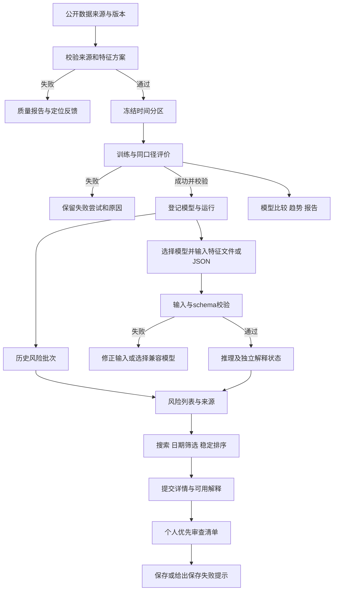
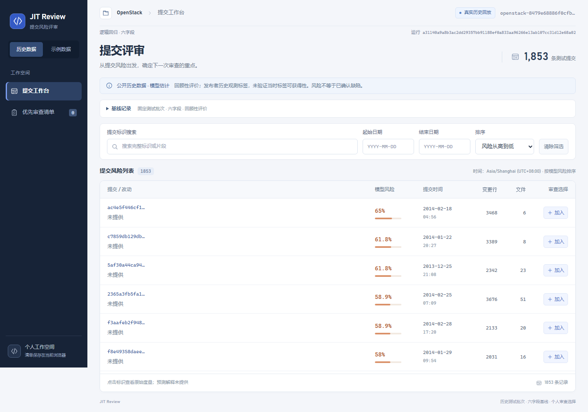
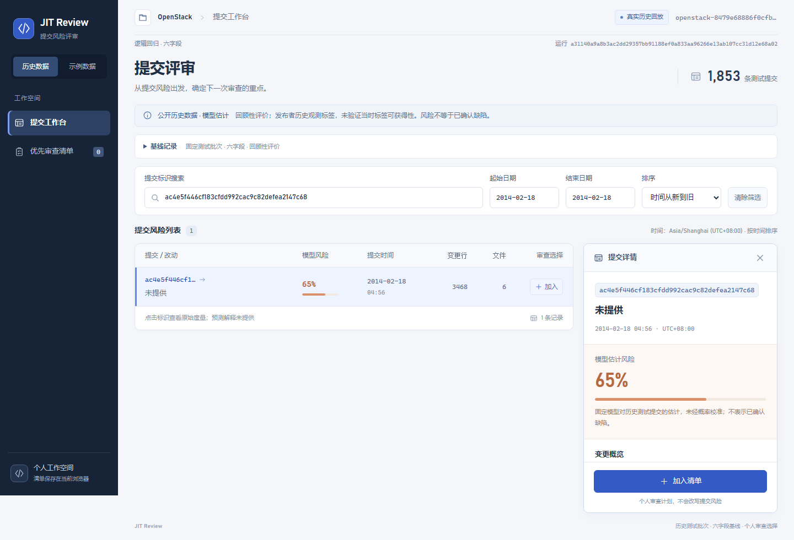

# JIT 缺陷预测系统 · 产品需求文档

## 前言

JIT Review面向代码评审员，提供提交风险、改动上下文和模型解释，帮助用户确定优先检查的变更。公开数据集管理、模型训练和实验比较支撑这条评审链路。

完整产品目标是团队通过局域网共用一套服务，集中使用数据集、模型和实验记录；新提交通过特征文件或JSON输入。现有公开历史数据基线和本机评审工作台保留；2026-10-14 后端增量实现已有模型登记、SQLite 持久目录、角色凭据、六字段单条 JSON 预测与结果重开。

当前前端已接入仓库分析、模型目录、六字段 JSON 手工预测与保存结果重开，按声明保留支持的真实归因。CSV、十二字段新输入、仓库逐条归因、账户系统、LAN 部署和完整共享 MVP 仍属后续范围；方法条目不等于已登记模型。

本文按照用户提供的需求模板编写，属于可评审的产品目标文档。未来目标由后续功能change实施；已有行为继续由现有OpenSpec主规格约束。配套技术说明见[产品设计文档](产品设计文档.md)。

## 一、版本信息

| 项目 | 内容 |
|---|---|
| 产品名称 | JIT缺陷预测系统／JIT Review |
| 版本号 | v1.0 文档基线评审稿 |
| 创建日期／更新日期 | 2026-10-12／2026-10-12 |
| 整理人 | Codex，按荀浩要求整理 |
| 审核人 | 待用户及团队实际评审 |
| 当前项目 | `D:/code/jit-defect-prediction` |
| 所属change | `define-shared-review-product-baseline` |
| 资料核对日期 | 2026-10-12；历史实验和截图沿用原记录日期 |
| 文档状态 | 文档技术检查与业务签审分别记录；尚未取得真实访谈或最终课程验收结论 |

## 二、变更日志

| 时间 | 版本号 | 变更人 | 主要变更内容 |
|---|---|---|---|
| 2026-10-12 | v1.0 | Codex（按荀浩要求） | 在本项目模板上建立新版需求：提交评审主线、特征输入、局域网共享；参考旧分析，重新说明当前能力、完整目标、验收和待决项 |
| 2026-10-16 | v1.0 | Codex（按荀浩要求） | change `connect-model-prediction-workbench`：补充工作台导航结构（模型中心／新建预测／预测结果）、模型中心与新建预测的低保真条目，并把 US-08／US-09 从待建改为已有单条六字段链路；CSV、全量预测历史与预测解释仍在首版之外 |

旧项目的版本史、审核结论和人员分工不作为本项目历史。后续修改应注明原因、影响故事与评审状态。

## 三、文档说明

### 名词解释

| 术语／缩略词 | 说明 |
|---|---|
| JIT | Just-in-Time Defect Prediction，以代码提交为单位估计缺陷引入风险 |
| 模型风险 | 正类预测分数，界面显示百分比；未经校准验证时不能当作实际发生概率或已确认缺陷 |
| 历史回放 | 对冻结历史测试批次执行模型推理；不代表已验证新提交的线上效果 |
| 在线预测 | 接收符合模型schema的新特征，调用已登记模型推理；不要求真实标签 |
| 特征schema | 字段名称、顺序、类型、单位、来源与转换规则的版本化契约 |
| Kamei14 | 五类共14项经典变更度量；准确语义和映射见设计§5.1.2 |
| 观测标签 | 发布者历史缺陷引入标记；未观测到不等于已证实无缺陷 |
| SZZ | 根据修复变更回溯可疑引入提交的标签构建方法；本期使用公开数据，不自建此管线 |
| Effort-unaware | 不考虑审查成本的评价，如ROC-AUC、AP、Precision、Recall、F1 |
| Effort-aware | 考虑审查成本的评价；当前为Recall@20%LOC，Popt等需独立定义 |
| AP | Average Precision，不能与其他PR曲线面积计算混称 |
| runId | 关联数据、分区、配置、环境、模型和实验产物的运行标识 |
| 解释 | 特定模型和输入的贡献说明；原始度量与历史标签不能代替模型解释 |
| MVP／Sprint／OpenSpec | 最小可行产品／迭代周期／管理规格与变更的工具 |

### 状态与确认程度

| 状态 | 内容／使用约定 |
|---|---|
| 已确认 | 用户确认保留提交评审主线；首版采用特征文件或JSON；团队共享服务，局域网可接受 |
| 已观察 | 历史回放与浏览器清单、五个经典方法、具名 schema；新增持久目录与六字段 JSON 后端接口，可从源码及各自规格核对 |
| 建议 | CSV文件、JSON单条输入、个人清单继续保存在浏览器；这些具体默认值尚未单独获用户确认 |
| 本轮已定／实施 | SQLite、CLI＋管理员 HTTP 登记、成员／管理员两类部署凭据；六字段单条 JSON 预测与结果重开 |
| 待决 | 任务执行器、后续账户机制与 LAN 部署、跨设备清单、完整14维数据来源、八模型组合、解释方法与资源预算 |
| 已有／部分已有／待建 | 功能表中的实现状态：已有仅表示当前范围代码和历史证据可查；扩展目标不能据此勾为已完成 |

在2026-10-12核对的[团队分工](团队分工.md)中，公开数据集路线已列为方向取舍。原始课程材料仍描述仓库挖掘；项目替代方案和教师沟通记录分别保留，不能改写课程原文。

## 四、需求背景

### 产品 / 数据现状

#### 4.1 问题与价值假设

评审员面对多个提交时，需要决定先检查什么，以及依据是什么。实验人员需要知道数据、模型、评价和结果之间是否能相互核对。产品把这些需求连接起来：可信数据与模型产生风险及解释，评审员结合改动上下文安排个人审查计划。

预期用户价值是更容易完成审查选择；通过真实任务走查检验。预期模型价值是在相同审查成本下覆盖更多历史观测正标签；通过固定测试清单和朴素排序对照检验。当前没有证据证明已减少线上缺陷、已提高实际评审效率或模型概率已校准。

#### 4.2 当前基础（2026-10-12源码／资料核对）

| 方面 | 已观察事实 | 依据 |
|---|---|---|
| 来源 | OpenStack发布者固定公开快照；原始26,855条，纳入12,374条 | [DATA.md](../backend/DATA.md) |
| 特征／模型 | `ns, nd, nf, ent, la, ld`六字段；一个固定逻辑回归，尚非完整Kamei14 | [配置](../backend/jit_baseline/config.py) |
| 时间分区 | train=8,669、validation=1,852、test=1,853；同秒不跨区，预处理只拟合训练 | [PROTOCOL.md](../backend/PROTOCOL.md) |
| 推理入口 | 本机只读`GET /api/review-batch`，实际调用冻结模型返回完整历史测试批次 | [API源码](../backend/jit_baseline/api.py) |
| 工作台 | React列表、详情、清单、搜索／日期／排序、模式切换及基线摘要 | [前端说明](../frontend/README.md)、[评审主规格](../openspec/specs/commit-risk-review/spec.md) |
| 保存 | 运行文件与manifest在服务端本机；个人清单在同浏览器和origin恢复 | [产物源码](../backend/jit_baseline/artifacts.py)、[清单源码](../frontend/src/shortlist.ts) |
| 尚待建设 | 共享部署、数据集管理与落库、完整14维、多模型、真实解释、新特征预测、比较与报告 | 本文完整目标，不能视为现有功能 |

[真实基线报告](evidence/connect-public-data-baseline-review/baseline-report.md)的冻结测试ROC-AUC为0.77098460，AP为0.38293952，阈值0.5的Recall为0.03496503，Recall@20%LOC为0.04195804。分类和工作量召回有限，应如实保留。这些是原历史运行结果；本轮只整理文档，没有重训或重新测量效果。

#### 4.3 目标用户与场景

| 用户 | 主要任务 | 界面入口 |
|---|---|---|
| 代码评审员（主用户） | 输入已准备特征，查看风险和解释，筛选提交并安排优先审查 | 在线预测、工作台、详情、个人清单 |
| 实验人员 | 核对数据及标签，冻结实验，训练、选择和比较模型 | 数据集、实验、模型比较、报告 |
| 数据／质量维护人员 | 注册公开数据，定位质量问题，维护可用版本和历史统计 | 数据质量、模型状态、趋势 |

部署目标是一台服务主机维护公共资源，团队成员通过局域网浏览器访问。共享数据集、模型和实验记录；个人清单是否跨设备保存、成员账户及写权限机制仍待决。用户画像为任务分析结论，真实频率和流程需调研验证。

### 用户调研

新项目资料未提供真实访谈记录，结论待补。旧项目的构造角色、演练引语和访谈计划不能移植为本项目实证。

建议邀请3–5名有评审经验的参与者，回顾最近一次真实任务，再走查“确认来源→找到提交→理解风险与解释→加入清单”。记录原有工具和排序方式、是否按PR／提交／文件评审、特征输入负担、误解、反例与分歧。人数、日期、耗时和成功率按实际采集填写。

| 待验证问题 | 所需记录 | 影响需求 |
|---|---|---|
| 额外风险排序是否有用 | 当前排序方式、困难、无需工具的反例 | 产品价值与列表默认行为 |
| 提交粒度是否匹配评审任务 | PR、提交、文件之间的实际关系 | 上下文和后续仓库链接 |
| 特征文件如何获得 | 提供者、准备步骤、用户能否完成 | 首版输入是否实用；自动提取优先级 |
| 用户如何理解分数和贡献 | 原话复述、信任边界、错误认识 | 风险和解释文案 |
| 共享如何影响工作 | 公共模型更新、个人清单、写操作责任 | 共享版本与访问控制 |

实际报告应附匿名证据索引、调研条件、支持与反对意见、对应故事及调整理由；当前不填写虚构支持率。

### 竞品分析

先比较能完成相邻任务的替代方式。以下官方／论文资料于2026-10-12核对；不包含同环境效果比较或真实竞品界面走查。

| 对比对象 | 主要信息 | 关键结论 | 截图或视频 |
|---|---|---|---|
| 人工按时间、规模、经验排序 | 评审者直接选择，无新增模型依赖 | 需要作为用户任务和排序对照，检验工具是否增加有用信息 | 待真实流程调研 |
| CodeQL | 通过代码数据库和查询生成扫描结果，支持代码安全与质量分析 | 借鉴来源、位置和告警反馈；本项目补充提交风险与审查选择，不断言优于扫描工具 | [官方说明](https://docs.github.com/en/code-security/concepts/code-scanning/codeql/codeql-cli)，未采集界面截图 |
| 提交风险研究 | Kamei等研究变更度量与考虑审查成本的提交级预测 | 借鉴可核验输入和评价方法；本项目收益需独立验证 | [原论文](https://posl.ait.kyushu-u.ac.jp/~kamei/publications/Kamei_TSE2013.pdf) |
| 当前JIT Review | 真实历史风险、原始度量、版本记录和个人清单已连接 | 延续已有评审操作，补真实解释、新输入与共享资源 | 第六章归档界面参考 |

独立竞品／用户调研报告属于后续证据补充。本轮不继承旧产品调研的访问日期或未核验结论。

## 五、需求范围

### 5.1 产品层级与信息架构

**2026-10-19 信息架构**：项目工作区（项目入口、仓库接入、固定成功分析、已分析提交、详情与审查计划）、实验室（具名历史验证/趋势、模型目录、手工预测、保存结果重开、独立演示）、设置（团队连接与外观）。默认项目入口不选择第一仓库。计划按仓库/成功分析/数据版本隔离；模型分数不等于缺陷概率或待审状态。

| Epic（业务目标） | Feature（功能模块） | 核心故事 |
|---|---|---|
| E1 数据可信且可重复使用 | F1.1来源与质量；F1.2特征与保存 | US-01／02／03；US-04／23／24 |
| E2 建立可追溯模型 | F2.1实验训练；F2.2评价与模型选择 | US-05／06；US-07／08 |
| E3 获得新提交风险依据 | F3.1特征输入；F3.2真实解释 | US-09；US-16 |
| E4 完成审查选择 | F4.1提交工作台；F4.2个人清单；F4.3失败恢复 | US-10～15；US-17／18；US-19 |
| E5 核对整体结果 | F5.1比较与趋势；F5.2结果导出 | US-20／21；US-22 |

主链路为公开数据→实验／模型→历史回放或新特征预测→风险／解释→审查清单；比较、趋势和报告用于复核模型及历史结果。过程任务单独关联change／看板，不充当业务故事。

2026-10-19 起共用空间壳与规范对象路由，旧模式/作业/batchId/日期地址核对真实来源后兼容。凭据在设置中显式确认且只在内存中保存，返回原对象；清除或更换后隔离旧请求。历史回放、演示、仓库与手工结果持续区分，新输入不借用历史指标。

### 5.2 当前增量、首个共享MVP与完整目标

| 层次 | 范围 | 验收依据 |
|---|---|---|
| 当前增量（已有） | 固定公开数据、六字段逻辑回归、本机历史服务、工作台与本地清单 | 当前CRR／PDB规格、源码和原日期运行证据 |
| 首个共享MVP（建议） | 两个局域网浏览器读取同一已登记模型；JSON单条／CSV特征输入→校验→真实风险与可用解释→详情和个人清单；数据来源及版本可核对 | 功能change的新规格、真实HTTP／多客户端操作、失败路径和版本证据；文档不代表已完成 |
| 完整核心产品（目标） | 本文24条关联故事，完整Kamei14、两类至少八模型、两类评价、解释、共享数据／实验、新输入、比较／趋势／导出，至少两项质量验证 | 范围内每条故事的正常与异常验收、正式数据／模型记录和非功能报告 |
| 可选扩展 | 仓库地址＋提交ID自动提特征、代码语义输入／定位、第二个公开项目、跨设备清单、自动CI接入 | 数据与资源前提核验后，单独评审范围并实施 |

完整14维的数据前提尚未满足：现有CSV无`lt`，经验列不能仅靠名称对应。新的公开数据版本必须核验语义与来源；六字段基线保留独立schema和协议。缺口不能用补零或改变旧报告消除。

### 5.3 首版输入与共享边界

- **已确认入口**：特征文件或JSON。调用方准备特征，服务器按所选模型schema校验并推理；用户无需提供真实缺陷标签。
- **建议默认值**：文件采用CSV，可包含多条；JSON采用单条。建议CSV上限10MiB／1,000条，整批校验失败时不发布部分成功；具体上限与策略在功能change中验证并冻结。
- 提交SHA／时间可作为上下文；未提供真实SHA时使用外部记录ID并明确“用户提供特征”，不能伪造仓库提交。没有标题、diff或真实解释时按状态显示未提供。
- **已确认共享资源**：数据集、模型、实验记录由服务端集中维护。局域网访问方式和写权限分别设计；上传／训练等公共写操作须有受控入口，认证方式待决。
- **建议清单边界**：同浏览器、origin、模式、数据版本与运行上下文内保存，不等同于账号同步。是否跨设备保存待决。

### 5.4 首版之外

仓库地址＋提交ID自动提特征、Git历史采集与自建SZZ管线不在首版。源码语义、代码行定位、缺陷自动修复、多租户权限、自动阻断合并、无人值守重训练及分布式训练另行评估。现有表格不能直接支撑缺陷类型分类、真实代码行定位或代码序列模型。

其中 Git 历史采集与简化 SZZ 已于 `add-git-repository-collection`（2026-10-18）落地为命令行能力，并在 `add-repository-sync-and-scoring`（2026-10-18）接成界面可用的同步作业：填公开 HTTP(S) 仓库地址后由后台串行完成采集、登记、训练（或按数据量降级到通用模型）与打分，结果按这次同步在工作台查看。仍未落地的是"仓库地址＋提交ID自动提特征"——当前不按单个提交 ID 现取特征，也没有实时增量同步、webhook 或定时任务；简化 SZZ 只按文件级回溯、未处理重命名与跨文件传播，标签仍不等于缺陷确认。

`add-repository-workspace`（2026-10-18）把"一次同步"进一步收成"一个仓库"：同一地址的多次同步归并到一条仓库记录，界面按仓库查看当前视图（最近一次成功同步），支持按标识／日期筛选与按风险或时间排序的服务端分页，并给出高／中／低风险分布。仍未落地的是多用户与按角色划分的数据边界（当前全团队共用一个成员凭据，仓库与清单不按人隔离）、多仓库并行同步（仍是单 worker 串行）、以及跨仓库的横向汇总。

这些边界控制完整目标的实现顺序；本change只完成文档，实际功能仍由后续change建设。

## 六、功能详细说明

### 产品流程图

图G-P1描述完整目标，其中数据集管理、多模型、新特征输入、真实解释和共享服务均待后续实施。当前固定历史基线已覆盖“历史批次→工作台→详情→清单”。



图示工具和原始任务记录见附录D。原始观测标签用于训练／离线评价，审查选择不回写成标签。用户主动切换示例模式时，来源和清单随对应上下文切换；真实服务失败提供重试，不自动替换为示例。

### 交互原型图

#### 已有界面参考

以下为2026-10-10真实链路运行留下的归档截图，本轮核看后引用；没有重新运行产品或截图，也不表示新功能已完成。





[归档优先审查清单](evidence/connect-public-data-baseline-review/screenshots/desktop-1440-real-shortlist.png) · [归档基线摘要](evidence/connect-public-data-baseline-review/screenshots/desktop-1440-real-baseline.png)

#### 低保真布局与状态

| 编号 | 页面／区域 | 布局及交互 | 必要状态 |
|---|---|---|---|
| UI-01 | 数据集（待建） | 上方版本／来源；左侧数据列表，右侧质量和字段说明；注册、导入、校验、重开入口 | 无版本、校验中、就绪、缺字段、失败行、损坏版本 |
| UI-02 | 实验（待建） | 上方选择数据／schema／模型；中部冻结分区和配置；下方运行与评价，失败另建重试 | 资格不足、queued、running、成功、失败、指标未定义 |
| UI-03 | 工作台（已有，接入新批次待建） | 左导航，顶部模式／来源／运行；查询栏；提交表格；右侧详情；清单数量 | 加载、空数据、无匹配、失败重试、来源不一致 |
| UI-04 | 提交详情（已有，真实解释待建） | 完整ID／时间／来源、风险、原始度量；独立解释区；关闭和加入按钮保持可操作 | 不存在、未提供、解释pending／ready／failed、已加入 |
| UI-05 | 个人清单（已有，共享版本策略建议） | 按加入顺序；打开详情、移除、返回工作台；显示保存／恢复反馈 | 空清单、已保存、保存拒绝、格式损坏、上下文不符 |
| UI-06 | 比较／报告（待建） | 选择实验组；指标表与成本曲线；来源、协议与导出入口 | 不可比、失败方法、报告不完整 |
| UI-08 | 趋势视图（已有） | 按时间桶分列观测比例与模型风险分布，标出分区带，给出估计与观测的差异洞察，每桶可下钻到工作台；附等价文本视图、来源与限制 | 未提供聚合、聚合不可用、样本不足、空桶与未知值有原因 |
| UI-07 | 特征预测（已有单条 JSON；CSV 待建） | 顶部模型／schema；表单六字段与粘贴 JSON 两个入口，同一份草稿；校验反馈；提交后在途禁用 | 未输入凭据、无可用模型、字段错误、导入被拒、提交中、保存成功、无法确认保存状态、推理失败 |
| UI-08 | 模型中心（已有） | 已登记模型列表与可用性／预测支持分列；展开完整来源与局限；管理员区显式打开后才读取本机候选并校验登记 | 未输入凭据、加载中、空目录、模型不可用、候选为空、登记新增、登记复用、上下文已变化、权限不足 |
| UI-09 | 预测结果（已有） | 风险、六项原始输入、来源与身份、限制、结果链接、按编号重开 | 未输入凭据、加载中、不存在、存储不可用、批次编号非法、模型已不可用仍可显示历史结果 |

图G-P2为UI-07的文本低保真草图，表达信息顺序与操作，不是已运行界面：

```text
+--------------------------------------------------+
| Model version | Feature schema | Source           |
+------------------------+-------------------------+
| CSV file input         | JSON record input       |
| sample schema / units  | schema fields / values  |
+------------------------+-------------------------+
| Validation: row / field / reason                  |
| Validate and predict                             |
+--------------------------------------------------+
| Batch / record / model / run | Risk | Explanation |
| Open detail -> Add to personal shortlist          |
+--------------------------------------------------+
```

中文对应：先选模型与字段契约，再提交文件或JSON，按行／字段显示校验结果，最后展示批次、模型、风险与解释状态。失败时保留可修正输入；模型或模式切换后，旧请求不能覆盖新结果。

「粘贴特征 JSON」只接受恰含六项数值的对象，下面这份示例可以直接粘贴进新建预测页；数值是人工格式示例，不是训练或效果记录：

```json
{"ns": 4, "nd": 7, "nf": 12, "ent": 2.25, "la": 120, "ld": 9}
```

示例刻意不带 `modelId`、`featureSchemaVersion`、`project`、`record` 这些请求包装字段：模型与项目由页面选择或填写，导入只负责六个特征值。缺少字段、多出字段、重复键、数组、字符串或布尔值都会被整体拒绝，且不改变表单里已有的内容。

### 功能说明

共24条核心业务故事。P0为主链路和数据／预测正确性，P1为核心分析与报告扩展；优先级和验收均属于本版评审稿。交互编号在本章原型表中定义。

| 序号 | 模块 | 功能 | 功能详细说明 | 交互图 |
|---|---|---|---|---|
| 1 | E1／F1.1 数据来源 | US-01 注册公开数据（P0，待建） | 作为数据维护者，我希望登记固定来源与版本，以便团队重复使用。**正常**：来源、hash、引用与字段说明形成可查询独立版本。**异常**：缺必需来源或校验定义时拒绝，不覆盖旧版本。 | UI-01 |
| 2 | E1／F1.1 数据质量 | US-02 导入与检查质量（P0，部分已有） | 作为实验人员，我希望判断输入是否可信，以便阻止坏数据训练。**正常**：展示原始／纳入／排除、缺失和标签统计，可定位原始行。**异常**：hash不符、重复ID、必需数值非法时失败，不静默删行或填零。固定来源已有检查，通用入口待建。 | UI-01 |
| 3 | E1／F1.1 标签 | US-03 核对标签语义（P0，部分已有） | 作为实验人员，我希望理解观测标签，以便正确评价模型。**正常**：显示映射、缺失处理和来源限制；输入与标签独立。**异常**：未知标签编码／来源不明时阻止训练，不默认负类。现有规则仅适用于固定快照。 | UI-01 |
| 4 | E1／F1.2 特征 | US-04 选择特征方案（P0，待建） | 作为实验人员，我希望选择语义可核验的schema，以便匹配模型。**正常**：展示六字段或完整14维的字段、单位、来源及完整性。**异常**：缺lt或经验含义不一致时标记缺口，不用其他列或零值凑维度。 | UI-01／UI-02 |
| 5 | E2／F2.1 分区 | US-05 冻结时间分区（P0，部分已有） | 作为实验人员，我希望按时间隔离样本，以便避免拟合读到测试信息。**正常**：成员与边界保存，同时间组不拆分；变换只拟合训练。**异常**：空分区、身份交叉或必要类别不足时失败。可配置实验入口待建。 | UI-02 |
| 6 | E2／F2.1 训练 | US-06 训练两类多模型（P0，部分已有） | 作为实验人员，我希望比较不同方法，以便选择适合评审的模型。**正常**：经典／深度两类总计至少八方法，逐项记录配置、耗时及结果。**异常**：不收敛、超预算或不兼容保留失败，不登记成功；改参数不凑方法数。当前仅一个逻辑回归。 | UI-02 |
| 7 | E2／F2.2 评价 | US-07 查看两类指标（P0，部分已有） | 作为实验人员，我希望核对准确性和审查成本，以便公平评价。**正常**：同测试集输出ROC-AUC、AP、P/R/F1和effort-aware评价，含阈值、预算和混淆矩阵。**异常**：无定义项为null并说明原因，不据测试效果改规则。完整指标扩展待建。 | UI-02／UI-06 |
| 8 | E2／F2.2 模型 | US-08 选择模型版本（P0，六字段手工预测已有） | 作为评审员，我希望选用可追溯模型，以便知道预测依据。**正常**：可查数据／run／schema和ready状态。**异常**：产物缺失、损坏或依赖不兼容的模型不可选，不暗用另一个模型。当前目录和六字段手工预测可选择可用模型，仓库分析按已记录策略选择模型。 | UI-03／UI-07 |
| 9 | E3／F3.1 预测 | US-09 输入特征并预测（P0，JSON 单条已有、CSV 待建） | 作为评审员，我希望提交文件或JSON特征，以便给新变更生成风险。**正常**：选择模型，校验schema后返回风险、来源和解释状态，可进入详情。**异常**：缺字段、多余标签、非法数值、重复记录或模型不可用时失败，不发布部分成功或示例分数。 | UI-07／UI-03 |
| 10 | E4／F4.1 来源 | US-10 确认与切换模式（P0，已有） | 作为评审员，我希望识别真实／示例来源，以便正确理解信息。**正常**：项目工作区、实验室、设置分别组织任务；各视图显示来源、项目、版本，历史有模型与runId，仓库固定成功分析，用户主动切换。**异常**：来源不全时不可用；迟到响应不覆盖新模式，服务故障不自动改为示例。 | UI-03／UI-05 |
| 11 | E4／F4.1 列表 | US-11 查看提交列表（P0，已有） | 作为评审员，我希望看到提交与改动规模，以便初步选择。**正常**：ID、时间、风险、行数及文件数一致，0与1为合法风险。**异常**：可选信息缺失显示未提供，无效风险显示无效，不能填为0。新输入列表接入待建。 | UI-03 |
| 12 | E4／F4.1 搜索 | US-12 搜索标识（P0，已有） | 作为评审员，我希望快速定位提交，以便核对指定变更。**正常**：片段匹配，忽略大小写与首尾空白，清空时保留其他筛选。**异常**：无匹配显示空结果和清除入口，不误报加载失败。 | UI-03 |
| 13 | E4／F4.1 日期 | US-13 按日期筛选（P0，已有） | 作为评审员，我希望查看指定时间的提交，以便限制审查范围。**正常**：Asia/Shanghai日期含两端，可单侧筛选并与搜索组合。**异常**：日期非法或起始晚于结束时提示并保留最近有效结果；无时间的新输入须标明不参加日期筛选。 | UI-03 |
| 14 | E4／F4.1 排序 | US-14 稳定排序（P0，已有） | 作为评审员，我希望按风险或时间排序，以便安排检查顺序。**正常**：风险降序，同分时间降序再完整ID升序；时间排序为时间降序再完整ID升序，同秒不以风险重排；无效风险最后。**异常**：排序不改变记录身份、详情或清单。无时间的新输入按目标规则处理并标明。 | UI-03 |
| 15 | E4／F4.1 详情 | US-15 查看一致详情（P0，已有） | 作为评审员，我希望核对同一变更，以便决定是否审查。**正常**：完整ID、同一风险／时间、原始度量及来源；关闭保留查询。**异常**：不存在记录提示返回；缺标题、diff或解释显示未提供。外部记录不能冒充真实Git提交。 | UI-04 |
| 16 | E3／F3.2 解释 | US-16 查看真实贡献（P0，按方法声明部分已有） | 作为评审员，我希望理解模型依据，以便知道优先检查什么。**正常**：解释绑定预测、模型／schema，含方法、基准、特征值与贡献方向，覆盖范围内可预测方法。**异常**：超时／失败／版本不符有独立状态；原始度量和历史标签不替代解释。 | UI-04／UI-07 |
| 17 | E4／F4.2 清单 | US-17 加入与移除（P0，已有） | 作为评审员，我希望维护优先审查计划，以便继续工作。**正常**：列表／详情加入，清单移除，按加入顺序显示，各视图数量一致。**异常**：重复加入不重复；空清单可返回选择；不修改风险、标签或模型。 | UI-03／UI-04／UI-05 |
| 18 | E4／F4.2 保存 | US-18 保存与恢复（P0，已有） | 作为评审员，我希望刷新后恢复选择，以便不中断计划。**正常**：同浏览器、origin 和来源恢复顺序；仓库再固定 repositoryId/viewSyncId/datasetVersion，历史固定 runId，旧 v1/v2 需预览并明确迁入。**异常**：存储损坏／不可用时提示且继续本次操作；不同运行不混清单。共享首版仍本地保存属建议，跨设备待决。 | UI-05 |
| 19 | E4／F4.3 恢复 | US-19 失败与重试（P0，已有） | 作为评审员，我希望看懂数据不可用原因，以便恢复工作。**正常**：区分加载、空与失败，重试成功清除错误。**异常**：服务／模型／来源失效时不显示旧批次或人工分数冒充成功；新接口状态待建设。 | UI-03／UI-07 |
| 20 | E5／F5.1 对比 | US-20 同口径模型比较（P1，待建） | 作为实验人员，我希望公平比较方法，以便选择模型。**正常**：相同数据／成员／标签／特征与评价协议的run并列，显示样本、指标和耗时。**异常**：测试集合或成本规则不一致时不可直接排名，失败方法不填成功指标。 | UI-06 |
| 21 | E5／F5.1 趋势 | US-21 查看历史趋势（P1，已有） | 作为质量维护者，我希望理解历史观测与风险变化，以便核对数据和模型。**正常**：独立趋势视图（`#/trends`，免凭据）按运行声明的粒度（当前按月，固定 UTC+08:00）显示样本数、观测正标签比例与范围，模型风险分布只覆盖测试分区并单独标注；图上标出各分区带，给出估计与观测的差异洞察（率差；按中位风险估计时标注近似），并可把任一时间桶下钻到工作台（地址带起止日期筛选）。**异常**：空桶／样本不足显示空值与原因、不写成 0%；运行未提供聚合时如实说明且不影响其它视图；不能将历史比例称实时缺陷率。 | 趋势视图（`#/trends`） |
| 22 | E5／F5.2 报告 | US-22 导出实验记录（P1，待建） | 作为实验人员，我希望带走完整记录，以便复核和汇报。**正常**：报告绑定run，包含来源、schema、分区、配置、指标、产物hash、失败与限制。**异常**：运行或关联不完整时不给成功报告；示例与真实结果不混合。 | UI-02／UI-06 |
| 23 | E1／F1.2 保存 | US-23 重开数据与结果（P0，部分已有） | 作为数据维护者，我希望重启后继续用已有版本，以便无需重新整理。**正常**：读取保存数据／成功run，核验来源与产物一致。**异常**：引用缺失／损坏则标不可用，不覆盖原成功版本；通用数据库重开待建。 | UI-01／UI-02 |
| 24 | E1／F1.2 兼容 | US-24 检查输入兼容（P0，部分已有） | 作为预测使用者，我希望避免错误字段进入模型，以便得到有效风险。**正常**：按模型schema校验名称、顺序、类型、单位和转换版本。**异常**：六字段／14维不匹配时拒绝，不猜别名或补零；当前仅固定六字段检查。 | UI-01／UI-02／UI-07 |

### 6.1 关键业务规则

1. 原始度量、训练标签、模型输入、模型风险、贡献解释和审查选择独立定义；清单不是标签或评审通过结论。
2. 模型比较使用相同数据版本、纳入、分区、标签、特征方案和评价协议；特征消融另设实验分组。
3. 学习到的预处理只拟合训练；验证用于预先约定的选择，测试只作冻结后评价。当前固定基线验证不参与调参／重拟合。
4. 列表筛选不重新计算完整实验指标；日期存储用UTC，界面筛选用注明的Asia/Shanghai。
5. 新版本产生新数据／运行上下文；旧结果、模型和清单不能暗中改写成新版本。
6. 时间切分不自动证明当时标签可得；未审计来源的限制须显示。缺失和未知值按契约反馈，不能伪装成零或已确认无缺陷。

## 七、非功能需求

以下为目标验证设计，阈值是建议验收目标，需在对应功能change冻结硬件、数据与协议后实测。本轮未执行这些测试；现有浏览器和故障记录按原日期引用，不能替代完整共享产品验收。

| 编号 | 质量需求 | 环境／样本／方法 | 建议目标 | 所需证据与当前状态 |
|---|---|---|---|---|
| NFR-01 | 性能（核心） | 记录服务主机CPU／RAM／依赖／模型；预热后，对每种可用模型至少200次合法单条JSON预测，单并发，最近秩P95；另测4个LAN客户端加载固定1,853条历史列表，记录网络与两视口 | 推理响应P95≤2秒；列表就绪≤3秒。冷启动、失败请求、排队及解释耗时单列；不隐藏失败 | 原始逐次计时、分位数方法、样本／模型／环境版本、错误数。**待实测**，原历史单次加载观察不代表该目标达标 |
| NFR-02 | 可靠性与完整性（核心） | 注入文件缺失／hash损坏、服务中断、保存拒绝、训练写入失败；并发注册同一数据版本；恢复正确产物并重试／按需重启 | 错误可定位，无示例替代或部分成功批次；坏产物无ready；重试保留attempt；已有成功版本不覆盖；并发注册不重复 | 注入步骤、HTTP、状态前后、manifest／文件hash、恢复结果。现有本机故障检查是基础，**共享写入待验证** |
| NFR-03 | 易用性与键盘操作（核心） | 1280×720及1440×900；仅键盘走完列表→详情→加入→清单→返回；真实走查另邀请未参与开发者 | 无页面级横向溢出；焦点可见、详情可滚动，关闭返回触发位置；模式和错误有文字说明 | 两视口系统记录和截图、焦点／滚动检查；访谈人数、耗时按实际填写。当前历史工作台有原证据，**新增页面待测** |
| NFR-04 | 共享访问与输入安全（核心） | 受控局域网入口；验证未获写权限的导入／训练请求、CSV大小与行数、非法路径／schema／数值；核对日志 | 公共资源写入有明确权限控制；超限或非法输入拒绝；客户端不能指定任意服务端文件路径；只加载服务器登记的可信模型，日志不含凭据 | 来源／授权／输入边界用例、配置、脱敏日志。认证方式待决，**未部署或验证** |

非功能验证至少落实NFR-01和NFR-02；其余需求按范围验证。模型效果以真实结果和朴素对照报告，不编造精度或召回达标线；解释属于必需功能验收，不仅靠“可解释性NFR”代替。

## 八、项目规划

### 8.1 阶段与交付

周数来自课程材料，实际日历日期与责任人由团队看板填入；当前日期不自动对应某个Sprint。以下说明目标阶段，不把已有代码推定为某阶段正式验收完成。

| 阶段 | 目标 | 交付与验证 |
|---|---|---|
| Sprint 0（第1–3周） | 产品、用户、MVP与协作基线 | 本文及设计评审；真实调研与数据可行性；原型、看板、规划change |
| Sprint 1（第4–6周） | 首条可运行链路 | 当前历史评审链路作为起点；共享MVP建议先落实数据／模型来源及特征输入→风险→详情→清单；保留成功与失败证据 |
| Sprint 2（第7–9周） | 核心功能与集成 | 兼容数据／14维、多模型、解释、共享存储、比较、趋势和报告；按小change分阶段交付 |
| Sprint 3（第10–14周） | 测试与问题修复 | 功能／集成／系统测试、至少两项非功能实测、缺陷记录和处置、规格与文档核对 |
| Final Release（第15–16周） | 最终验收与展示 | 可运行共享系统、用户手册、测试报告、展示材料；范围内change按流程验证和归档 |

### 8.2 分工与过程证据

参照[团队分工](团队分工.md)的能力席位：A算法与实验、B数据与服务、C前端及测试组织、D文档与演示；具体姓名、工作量和日期待团队安排。该文件中的旧状态判断、评分预估或未经核验字段建议不当作完成证据。

每个实施项关联`US → change/task → 看板／Issue → PR → 验收证据`。成员贡献、非作者审阅、问题处置和周报按实际发生记录；文档完成和测试通过不等于真实访谈、用户批准或最终课程验收。

### 8.3 待决与风险

| 事项 | 处理路径 |
|---|---|
| 完整Kamei14公开数据 | 优先核验来源、lt和经验语义；六字段继续独立保存，不偷偷扩大Git采集范围 |
| 特征输入的实际可用性 | 用户走查确认由谁准备、负担和上下文；自动Git提特征是后续扩展 |
| 共享写权限／个人清单 | 首版访问控制、登录及跨设备策略需功能change确定；公共资源和个人选择分别设计 |
| 数据库／执行器／部署主机 | 设计列候选和验证门槛，再按并发、任务及运维需求选型 |
| 八方法与解释预算 | 先核验一经典一深度的输入／重载／解释和资源，再扩展；失败如实记录 |
| 历史标签和未来信息 | 保留观测与时间局限；时间切分不能证明标签在历史当时可得 |
| 课程路线口径 | 公开数据集替代／自建SZZ可选需实际教师沟通记录；不在本文编造批准 |
| 验证证据被覆盖 | 与在途证据隔离change协同，原归档报告不能作为滚动测试输出 |

## 附录

### 附录A：数据分析报告

- [公开数据说明](../backend/DATA.md)：固定来源、原生字段、标签与质量统计。
- [冻结协议](../backend/PROTOCOL.md)：当前纳入、时间分区、训练与评价规则。
- [真实历史基线报告](evidence/connect-public-data-baseline-review/baseline-report.md)：原运行结果、独立复现与局限。
- 完整14维的数据可行性报告：待来源核验后补充；现有六字段统计不能替代。

### 附录B：用户调研报告

新项目真实调研报告待补，执行与记录要求见第四章。本文的画像和价值假设不视为访谈结论，旧模拟调研不作为实证。

### 附录C：设计分析报告与依据

- [产品设计文档](产品设计文档.md)：架构、数据、契约、时序和需求映射。
- [OpenAPI离线契约](api/openapi.yaml)、[全局错误码表](全局错误码表.md)：逐项区分现有和计划接口。
- [课程项目要求](课程资料/2026-2027-1%20软件开发与测试综合实训%20项目要求.md)、[团队分工](团队分工.md)。
- [评审主规格](../openspec/specs/commit-risk-review/spec.md)、[公开基线主规格](../openspec/specs/public-data-baseline/spec.md)、[历史功能验收记录](evidence/connect-public-data-baseline-review/acceptance.md)。
- 只读旧参考：`D:/code/mycode/jit-defect-prediction/docs/需求与设计/产品需求文档.md`及同目录`产品设计文档.md`。借鉴其用户问题和可追溯原则，旧飞书链接、审核史与实现不继承。

### 附录D：模板与图示生成记录

结构依据：[本项目需求模板](产品需求文档（模板）%20.md)，原件保留。图G-P1（目标流程）与G-P2（UI-07低保真布局）由Codex以文本方式编写，载体为Mermaid／ASCII；没有调用图像生成工具。G-P1依据本章故事和产品边界，G-P2依据UI-07的信息顺序。

原始任务提示词：

> `D:\code\mycode\jit-defect-prediction 借鉴原来的需求文档设计文档 重新弄一份需求文档、设计文档`
>
> `我放了两个模板在那儿 可以在模版基础上修修补补`

后续用户已确认提交评审主线、特征文件／JSON、局域网共享，并调用本change的propose和apply。图示依据为这些决定、当前源码与主规格、课程资料、本章目标；技术选型未确认部分保持候选。已有两张截图来自原归档真实链路，本轮核看后引用，未修改。
